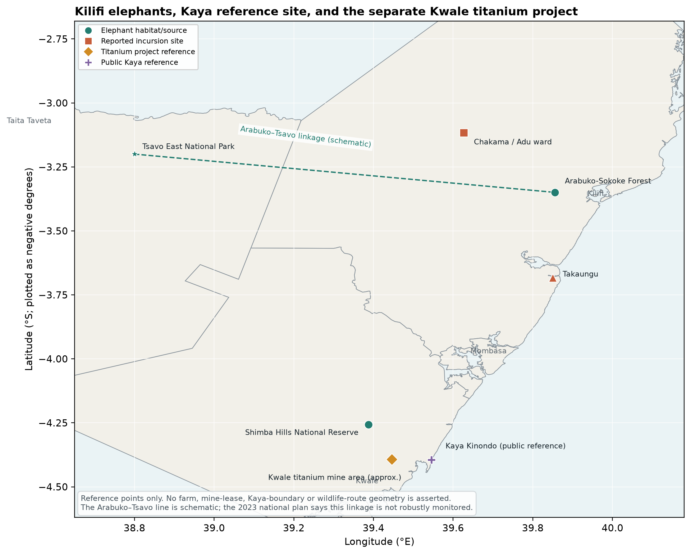
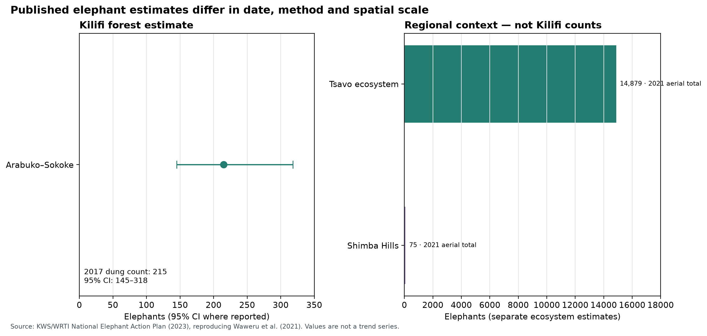
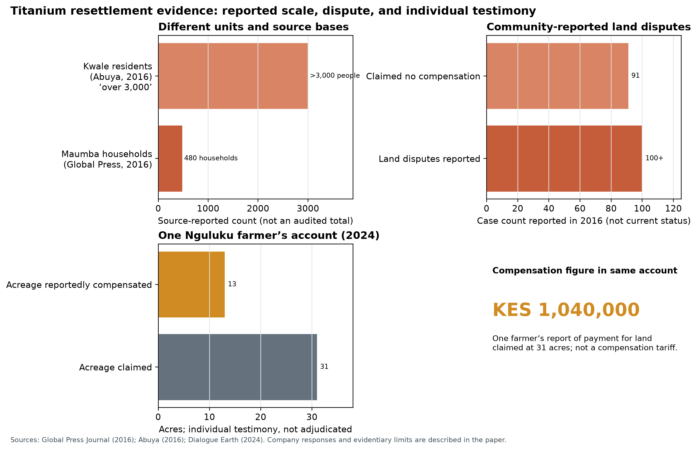
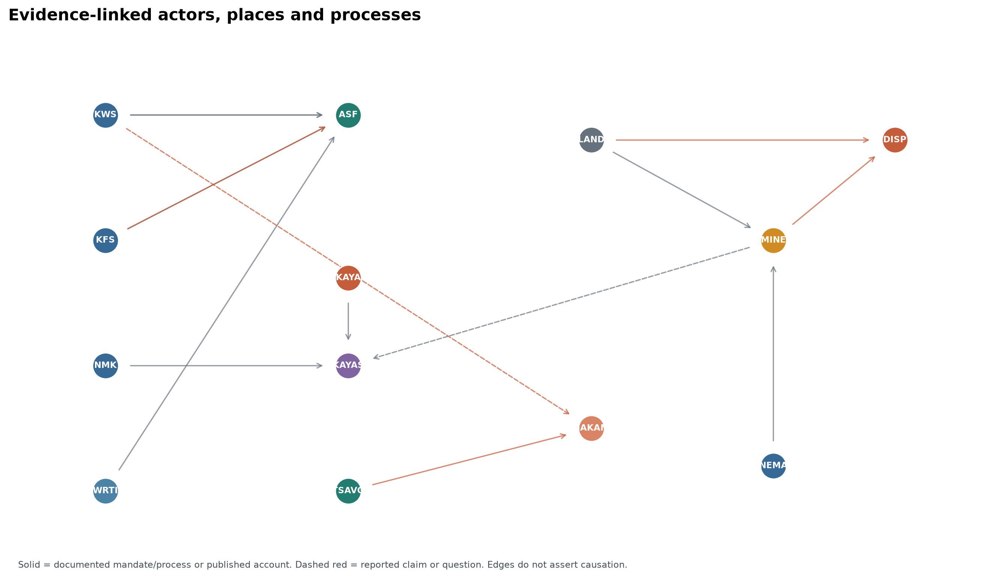
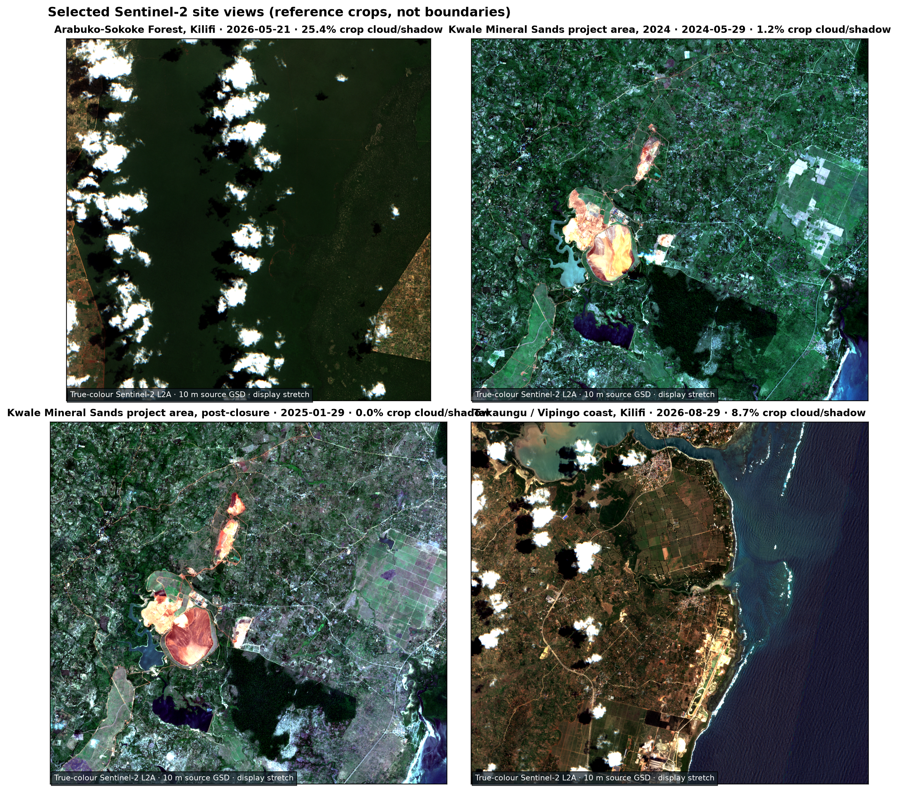
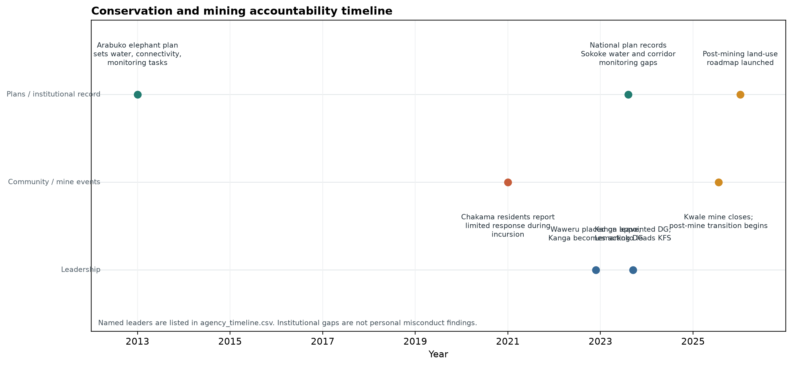
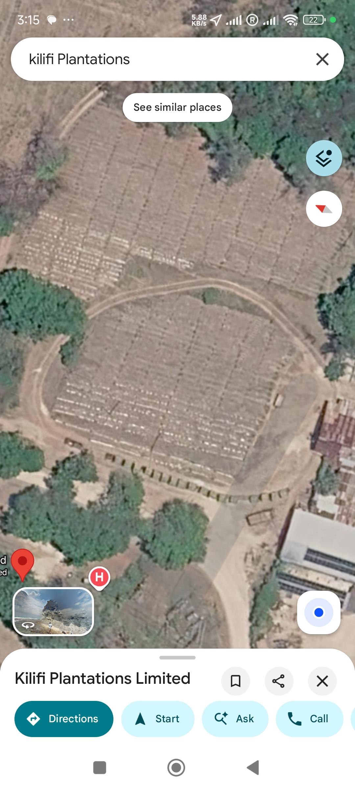

::: {custom-style="Title"}
MAJAJANI FARMS
:::

::: {custom-style="Subtitle"}
Banana-Based Soil Building, Imperial Power, and Land Accountability in Coastal Kenya
:::

::: {custom-style="Subtitle"}
A documentary perspective on Mijikenda land, Kaya stewardship, elephants, graft, and titanium mining in Kilifi and Kwale
:::

::: {custom-style="Author"}
By William Majanja
:::

::: {custom-style="Author"}
Majajani Farms, Kilifi County, Kenya; managed with Agripulse
:::

::: {custom-style="Author"}
Research paper prepared for academic submission to the Open University of Kenya
:::

::: {custom-style="Date"}
Documentary research perspective · 15 October 2026
:::

## Abstract

I situate my reported banana-based soil-building practice at Majajani Farms within coastal Kenya’s land, water, heritage and wildlife disputes. I ask what public records and community-attributed accounts can establish about ecological restoration and land authority, and what remains unmeasured. I use a targeted documentary method through 15 October 2026, drawing on statutes, judgments, agency plans, declassified intelligence records, research, environmental assessments and attributed journalism; I conducted no new interviews, field sampling or soil measurements. I report that I have used Grand Nain and local plantains, manure and associated fruit trees at the farm for approximately ten years, but make no claim of measured restoration. I distinguish Arabuko-Sokoke’s 2017 elephant estimate and reported Tsavo elephant crop raids in Kilifi from the Kwale titanium project’s land acquisition and resettlement disputes. I examine documented public-sector graft and impunity without attributing unproven misconduct to plantation companies. A declassified 1987 CIA assessment, written after the failed 1982 Air Force-led coup attempt, describes Moi-era consolidation, elite land concentration, government graft, colonial administrative inheritance, and U.S.–Kenyan security ties; I use it as evidence of contemporaneous U.S. intelligence analysis, not proof that the CIA caused the Kenyan land or water disputes examined here. I compare the 2024 Gen Z-led protests and documented state violence with Guatemala’s CIA-backed 1954 coup, distinguishing domestic repression from foreign-engineered regime change, and consider Haiti’s externally supported police missions as a separate accountability case. I record that *Mkono wa Tembo* is so named because of the elephant trunk-like pattern on its outer skin, and treat historic elephant feeding on that cultivar as a hypothesis. I argue that ecological repair must be assessed alongside land and water rights, community authority, recognition and benefit-sharing. I provide maps, source-tagged data and satellite images as documentary aids, not as causal or cadastral proof.

**Index Terms—** banana-based soil building; agroecology; political ecology; Mijikenda; Kaya; elephants; graft; impunity; banana republic; CIA; Guatemala; land tenure; titanium mining; Kenya.

## Table of Contents

| Section | Page |
|---|---:|
| Abstract and keywords | 2 |
| Table of Contents | 3 |
| List of Figures | 5 |
| List of Tables | 6 |
| List of Appendices | 7 |
| Table of Authorities | 8 |
| Abbreviations and Key Terms | 11 |
| I. Introduction: purpose, research questions, and scope | 12 |
| I-A. Research questions and contribution | 12 |
| I-B. Conceptual framework | 13 |
| I-C. Sources and documentary method | 13 |
| I-D. Positionality, ethics, and limits | 14 |
| II. Majajani Farms: banana-based soil development | 14 |
| II-A. Planting material and local varieties | 14 |
| II-B. The living banana as a biological soil-building component | 15 |
| II-C. Associated crops and intercropping notes | 15 |
| III. Kilifi’s tree-food landscape and plantation history | 16 |
| III-A. Climate, vegetation, and historical change | 17 |
| III-B. Water scarcity, plantation withdrawals, and community survival | 17 |
| IV. Land rights, corporate distinctions, and accountability | 19 |
| IV-A. Relevant land and environmental proceedings | 20 |
| IV-B. Kakuzi PLC as a comparison | 22 |
| IV-C. Proposed community role for Wajibika-Mazingira | 23 |
| IV-D. Imperialism, graft, intelligence, and the “banana republic” comparison | 23 |
| V. Kilifi elephants, Kaya homelands, and the Kwale titanium legacy | 27 |
| V-A. Elephant populations and Kilifi crop-raiding reports | 27 |
| V-B. Institutional mandates, documented gaps, and leaders | 27 |
| V-C. Kwale titanium: acquisition, relocation, and remedy | 29 |
| V-D. Kaya heritage and limits of spatial evidence | 30 |
| V-E. Mokono/Mkono wa Tembo and the elephant-food hypothesis | 31 |
| VI. Evidence needed to evaluate the Majajani pilot and land-history claims | 36 |
| VII. Conclusion | 38 |
| Appendix A. The train at the sisal processing/loom area | 40 |
| Appendix B. Foot-and-mouth disease: an exploratory historical note | 41 |
| Author declarations, ethics, and data availability | 42 |
| References | 43 |

## List of Figures

| Figure | Title | Page |
|---|---|---:|
| 1 | Reference map: Kilifi elephants, Kaya reference site and Kwale titanium project | 32 |
| 2 | Published elephant estimates, with methods and uncertainty | 33 |
| 3 | Kwale titanium resettlement: source-reported figures and one farmer’s account | 33 |
| 4 | Evidence-linked agencies, communities, sites and processes | 34 |
| 5 | Sentinel-2 site views: Arabuko-Sokoke, Kwale Mineral Sands and Takaungu/Vipingo | 35 |
| 6 | Timeline of elephant plans, reported response, leadership and mine closure | 36 |

## List of Tables

| Table | Title | Page |
|---|---|---:|
| 1 | Agency mandates, documented gaps and leadership periods | 28 |

## List of Appendices

| Appendix | Title | Page |
|---|---|---:|
| A | The train at the sisal processing/loom area | 40 |
| B | Foot-and-mouth disease: an exploratory historical note | 41 |

## Table of Authorities

### Cases and judicial proceedings

| Authority | Citation | Cited in |
|---|---|---|
| *Mwangome & another v Vipingo Development Ltd & 6 others* | [2023] KEELC 257 (KLR) | §IV-A |
| *Mwangombe & 6 others v Rea Vipingo Plantations Ltd & 9 others* | [2025] KEELC 7032 (KLR) | §IV-A |
| *Vipingo Development Ltd & another v Kai & 6 others* | [2025] KEELC 8666 (KLR) | §IV-A |
| *Kilifi Plantation Ltd v Karimi* | [2026] KECA 910 (KLR) | §IV-A |
| *Kamau & 7 others v Republic* | [2026] KEHC 11673 (KLR) | §IV-A |
| *Kakuzi PLC v National Land Commission & 8 others* | [2026] KEELC 2374 (KLR); [2026] KEELC 4157 (KLR) | §IV-B |
| *Base Titanium Ltd v Kiswili (on behalf of 65 others) & 3 others* | [2025] KECA 1330 (KLR) | §V-C |
| *Rodgers Muema Nzioka & 2 others v Tiomin Kenya Ltd* | Mombasa Civil Case No. 97 of 2001 | §V-C |
| *Rodgers Mwema Nzioka v Attorney General & 9 others* | [2007] eKLR, Misc. Civil Application No. 613 of 2006 | §V-C |
| Malindi Chief Magistrate’s Court Anti-Corruption Case No. 1 of 2019 | Convictions 17 April 2026; sentences 26 May 2026; appeals noted in *Kamau & 7 others v Republic* | §IV-A |

### Legislation

| Authority | Citation | Cited in |
|---|---|---|
| Constitution of Kenya | 2010, arts. 60, 63, 67(2)(e), 69–70 | §§IV, V-B |
| Community Land Act | No. 27 of 2016 | §§IV, V-D |
| National Land Commission Act | No. 5 of 2012 | §IV |
| Environmental Management and Co-ordination Act | No. 8 of 1999 | §§III-B, IV-A |
| Environmental (Impact Assessment and Audit) Regulations | Legal Notice No. 101 of 2003 | §IV-A |
| Wildlife Conservation and Management Act | No. 47 of 2013 | §V-B |
| Forest Conservation and Management Act | No. 34 of 2016 | §V-B |
| National Museums and Heritage Act | No. 6 of 2006 | §V-B |
| Mining Act | No. 12 of 2016 | §V-C |
| Water Act | No. 8 of 2002; No. 43 of 2016 | §§III-B, IV-A |
| Water Resources Management Rules | Legal Notice No. 171 of 2007 | §III-B |
| Water (Resources) Regulations | Legal Notice No. 58 of 2025 | §§III-B, IV-A |
| Environmental Management and Coordination (Water Quality) Regulations | Legal Notice No. 177 of 2024 | §§III-B, IV-A |

### Official plans, institutional records and reports

| Authority | Citation | Cited in |
|---|---|---|
| *Kenya: Hard Times Ahead: An Intelligence Assessment* | CIA Directorate of Intelligence, ALA 87-10003, January 1987; declassified in part 30 July 2012 | §IV-D |
| *Kenya: Current Issues and U.S. Relations* | CRS Report R48072, Library of Congress, updated 6 March 2026 | §IV-D |
| U.S. Embassy Nairobi cable 10NAIROBI11 | “Kenya: Inadequate Witness Protection Poses Painful Dilemma,” 5 January 2010; published by WikiLeaks | §IV-D |
| Anti-Finance Bill protest monitoring statement | Kenya National Commission on Human Rights, 1 July 2024 | §IV-D |
| 2024 Country Reports on Human Rights Practices: Kenya | U.S. Department of State, 2025 | §IV-D |
| June 2026 Gen Z anniversary protest statement | Kenya National Commission on Human Rights, 29 June 2026 | §IV-D |
| *Guatemala: Memory of Silence* | Commission for Historical Clarification, 1999 | §IV-D |
| Security Council Resolution 2699 (2023) | S/RES/2699 (2023), authorization of the Multinational Security Support Mission in Haiti | §IV-D |
| *Haiti in Crisis: Developments Related to the Multinational Security Support Mission* | CRS In Focus IN12331, Library of Congress, updated 3 June 2025 | §IV-D |
| Arabuko-Sokoke Forest Elephants Conservation Action Plan | Arabuko-Sokoke Forest Management Team, 2013 | §V-B |
| National Elephant Action Plan for Kenya | KWS/WRTI, 2023–2032 | §§V-A–V-B |
| National Human–Wildlife Coexistence Strategy and Action Plans | Ministry of Tourism and Wildlife, 2023–2032 | §V-B |
| Revised nomination dossier for the Sacred Mijikenda Kaya Forests | UNESCO World Heritage Centre, 2016 | §V-D |
| Environmental and Social Impact Assessment, North Dune Extension | Base Titanium, 2021 | §V-C |

## Abbreviations and Key Terms

| Term | Meaning as used here |
|---|---|
| ASF | Arabuko-Sokoke Forest |
| CEH | Commission for Historical Clarification (Guatemala) |
| CIA | Central Intelligence Agency |
| CWWDA | Coast Water Works Development Agency |
| EIA | Environmental impact assessment |
| ELC | Environment and Land Court |
| FMD | Foot-and-mouth disease |
| GSF | Gang Suppression Force (Haiti) |
| HEC | Human-elephant conflict |
| KALRO | Kenya Agricultural and Livestock Research Organization |
| KFS | Kenya Forest Service |
| KIMAWASCO | Kilifi-Mariakani Water and Sewerage Company |
| KWS | Kenya Wildlife Service |
| MINUSTAH | United Nations Stabilization Mission in Haiti |
| MSS | Multinational Security Support Mission (Haiti) |
| NEMA | National Environment Management Authority |
| NLC | National Land Commission |
| NMK | National Museums of Kenya |
| ODPP | Office of the Director of Public Prosecutions |
| PMLU | Post-mining land use |
| WRA | Water Resources Authority |
| WRTI | Wildlife Research and Training Institute |
| Kaya | A Mijikenda ancestral home/settlement and sacred cultural landscape; customary authority rests with relevant communities and custodians, not with a map label alone. |
| Decortication | Mechanical separation of sisal fibre from the leaf; distinct from weaving fibre on a loom. |

## I. INTRODUCTION: PURPOSE, RESEARCH QUESTIONS, AND SCOPE

At Majajani Farms, we are developing a system that combines living banana plants, animal manure, local crop varieties, and fruit trees to build a favorable horticultural environment. The pilot has developed over approximately ten years under my management with Agripulse. I place this work in Kilifi’s wider history of land and ecological change. I will not claim measured soil restoration, biodiversity recovery, income gains, or disease causation without the data to demonstrate them.

To keep political commitment from blurring the evidentiary record, I distinguish five claim types: judicial findings and legal texts; official and technical records; academic research; attributed community testimony and journalism; and my interpretation or hypothesis. I identify the source of a statement where possible and distinguish a court’s procedural decision from a decision on the merits.

I present this as a documentary case perspective, not a systematic review or empirical agronomy study. I did not conduct interviews, field inspection, archival surveys, soil sampling, or an independent trade audit for this paper.

I draw on my farm account, Pan-African scholarship, Kenyan land scholarship, Mijikenda community knowledge, public institutional records, legislation, and court judgments available through 15 October 2026. I do not infer ancestry from a name. When a source does not document an individual’s background, I identify only an institutional or community role that I can verify. I do not use corporate communications as independent evidence of land rights or environmental performance. I include the source register in the companion repository. I did not use predefined search criteria, so this is not a systematic review.

Baobab foodways and coastal tree-based farming are not decorative remnants to be admired while communities lose control of land. They are living systems of knowledge, food security and ecological inheritance. Takaungu carries the history of plantation slavery; British rule later used taxation, labour coercion and military force against Giriama resistance. In my Pan-African reading, the plantation economy redirected land and labour toward export production and weakened community authority over place. I ground this historical framing in coastal Kenya’s plantation history and scholarship on Giriama resistance; it does not establish that every named modern company committed colonial-era acts or owns a parcel implicated in a specific conflict [1], [2].

### I-A. Research questions and contribution

I ask three linked but geographically differentiated questions:

1. What can the available farm, agronomic and botanical record establish about banana-based soil-building at Majajani Farms, and what measurements remain necessary?
2. How do water access, land tenure, wildlife management and community authority shape ecological repair and livelihoods in Kilifi’s coastal landscapes?
3. What do court records, resettlement reporting, environmental assessments and Kaya heritage sources establish about titanium-related displacement in Kwale—and where do they leave site-level claims unresolved?

I argue that ecological restoration cannot be evaluated solely through crop performance or a corporate sustainability narrative. I also assess how colonial land alienation, post-independence land administration, and contemporary foreign-backed security cooperation shape authority and access to remedy, while testing each proposed causal link against evidence. I assess who controls land and water, whose knowledge is recognized, how conservation burdens and benefits are distributed, and whether communities have meaningful access to decisions and remedies. I use the Kwale titanium project as a comparative case of state-facilitated extraction and displacement, not as a proxy for Kilifi’s elephant routes or evidence that a named Kaya forest was mined.

### I-B. Conceptual framework

I combine political ecology, environmental justice and a Pan-African account of extraction. Political ecology directs my attention to how resource access is mediated by law, tenure, institutions and unequal power rather than treating scarcity or ecological degradation as purely technical problems [3], [4]. Environmental justice adds distributive questions—who receives water, land and mining revenue; procedural questions—who can participate in licensing, compensation and land-use decisions; and recognitional questions—whether Mijikenda custodians’ relationships with land, food species and Kaya forests are treated as knowledge and authority [5], [6]. I draw on Walter Rodney, Ngũgĩ wa Thiong’o and Wangari Maathai for a Pan-African critique of extraction and epistemic hierarchy [7]–[10]; their arguments guide my interpretation but do not substitute for parcel, hydrological or ecological evidence.

I engage selected, relevant works by Maina wa Kinyatti rather than claim to catalogue his entire publishing corpus. In *Kenya’s Freedom Struggle: The Dedan Kimathi Papers*, Kinyatti edits and presents movement documents; *Mau Mau: A Revolution Betrayed* and *History of Resistance in Kenya, 1884–2002* place armed resistance within a longer popular history; *Kenya: A Prison Notebook* records political imprisonment; *Mwakenya: The Unfinished Revolution* assembles documents from the later underground movement; and *Thunder from the Mountain* preserves Mau Mau songs as political culture [11]–[16]. Across these works, I read Kinyatti’s Marxist, anti-imperialist argument as holding that formal independence did not, by itself, end external economic influence, elite control, or struggles over land and self-determination. I present this as Kinyatti’s interpretation, not as a settled consensus or a proxy for all Kenyan or Mijikenda perspectives. I use it to frame questions about land, historical memory, and benefit-sharing, then test specific claims against legal records, archives, and other scholarship.

### I-C. Sources and documentary method

I conducted a targeted documentary analysis of records available through 15 October 2026. My source set includes Kenyan statutes and judgments, KWS/WRTI and KFS plans, UNESCO and National Museums of Kenya documents, peer-reviewed research and a thesis, environmental assessments, company materials, and attributed reporting from Kenya News Agency, Global Press Journal, The Eastleigh Voice, The Star and Dialogue Earth. I use court and agency records to establish what a body decided, reported or was mandated to do; I use journalism for attributed witness accounts and public reporting; and I treat company statements as the company’s position, not as independent verification. I distinguish the 2024/2025 Kwale mine-closure material from the 2007 resettlement period and from older licensing decisions.

I identified records through targeted searches of Kenya Law, agency and ministry repositories, university repositories, the UNESCO World Heritage Centre, the CIA FOIA Electronic Reading Room, and scholarly/news indexes, followed by reference checking. I paired company, place and institution names with terms such as *Kaya*, *elephant*, *corridor*, *titanium*, *resettlement*, *compensation*, *borehole*, *royalty*, *land concentration* and *security cooperation*. My source register logs the documents I used. I treat the CIA’s January 1987 *Kenya: Hard Times Ahead* as a contemporaneous, then-classified intelligence assessment produced after the failed 1982 Air Force coup and partly redacted on release in 2012. I attribute its judgments to CIA analysts and the U.S. Embassy reporting they cite. It is not a Kenyan land survey, a neutral account of community experience, or evidence of covert CIA direction of local land transactions. This is a focused documentary review, not a systematic review: I did not produce search counts, exclusion logs or exhaustive database coverage.

I apply the five claim types defined above in the prose and companion evidence tables; I describe conflicts rather than resolve them by adding unlike estimates or privileging corporate communications. I use public reference coordinates and administrative outlines in the maps, and satellite crops only for visual context. These are not impact assessments, title surveys or wildlife-route maps. I created no new fieldwork, interview, soil, title-chain, household-census or elephant-tracking dataset for this paper.

### I-D. Positionality, ethics, and limits

I am associated with Majajani Farms and have a direct interest in the farm account presented here. I therefore treat my observations as attributed farm evidence, not independent measurement. I write from Pan-African commitments but do not claim to speak for all Mijikenda communities. I conducted no new human-subject research; I do not present community memory or restricted Kaya knowledge as interview findings. I believe any doctoral fieldwork should be co-designed with relevant Kaya custodians and residents, with prior consent, community control over sensitive locations and records, transparent attribution, and a benefit-sharing plan. Parcel-level conclusions require cadastral archives; water-causation conclusions require metered abstraction and aquifer data; agronomic conclusions require replicated baseline and follow-up measurements.

## II. MAJAJANI FARMS: BANANA-BASED SOIL DEVELOPMENT

### II-A. Planting material and local varieties

I use Grand Nain (also spelled Grand Naine) as the principal banana base and have incorporated the coastal plantain known in Kenya Agricultural and Livestock Research Organization (KALRO) material as *Mkono wa Tembo* and in my local/farm account as *Mokono wa Tembo*. In ordinary Swahili, *mkono wa tembo* literally reads as “elephant’s hand”; the local interpretation I record here is that the plant is called *mkono wa tembo* because of the elephant trunk-like pattern on its outer skin, and some also read the long, stretched fingers as resembling an elephant’s trunk. I present that interpretation as community-linked ethnobotanical knowledge, not as a dictionary definition. I have not yet documented the names of every local variety used. KALRO’s coastal banana work provides Kenyan agronomic context; it does not establish that KALRO supplied or endorsed all planting material at Majajani Farms [17].

I have described the incorporation of local varieties as “grafting.” KALRO’s banana training manual describes planting material such as suckers and tissue-culture plantlets; conventional grafting is not the standard banana propagation method [18], [19]. Until I document the exact protocol, I describe our practice as cultivar integration followed by sucker propagation with animal manure and regular soil care. Recording mother plants, propagation steps, and selected traits will let other African growers and researchers assess and reproduce the work accurately.

### II-B. The living banana as a biological soil-building component

At Majajani, we treat the living banana as a biological worker in the soil-building system. Roots interact with soil structure; root turnover and root-derived inputs contribute organic material; retained leaves and pseudostems return biomass and nutrients to the planting area. Cattle and goat manure add organic matter and nutrients. Bananas cycle nutrients already in the soil or supplied to the field; they do not manufacture mineral nutrients. Harvested fruit and removed biomass also carry nutrients away. These are established processes in root biology and banana-based agroforestry, not measured outcomes at Majajani [20]–[22]. Recording inputs and removals will let us test whether the system is rebuilding soil fertility or drawing down existing nutrient stores.

KALRO’s Kenyan banana training materials recommend manure, mulch, and soil-water management [18]. Wangari Maathai’s work with the Green Belt Movement demonstrates how community-led tree planting can connect ecological repair with women’s livelihoods and local stewardship [9], [10]; Mijikenda foodway documentation likewise records tree care as living community knowledge [23]. These sources inform our approach but do not measure its results at Majajani. We will judge our practice by soil tests, plant performance, water observations, and harvest records—not by intention alone.

I foreground the farm pilot as this paper’s primary practice-based contribution. Its proposed soil-building pathway is explicit and testable: living banana cover and roots, retained plant biomass, manure inputs, and associated trees, with suckers propagated to multiply selected cultivars. I have not yet generated baseline or follow-up measurements to determine whether these processes have increased soil organic matter, improved structure, or raised yields at Majajani. The pilot’s value here is that it identifies a locally managed system and a practical measurement agenda, rather than claiming a result before collecting the data.

### II-C. Associated crops and intercropping notes

Custard apple and jackfruit are associated fruit trees; Earth Lungs has recently added hibiscus. Their compatibility with banana depends on spacing, water, shade and management. The hibiscus variety and intended role have not yet been recorded, and no yield or competition data are reported.

## III. KILIFI’S TREE-FOOD LANDSCAPE AND PLANTATION HISTORY

Baobab is not an ornamental remnant in Kilifi; it is a food tree, a source of livelihood, and a carrier of knowledge. A Mijikenda foodways project led by Kenyan ethnobotanist Patrick Maundu worked with Kaya elder Hillary Mwatsuma and community custodians to document baobab material traditions and related expertise [23]. A locally focused study likewise records Mijikenda knowledge and management practices surrounding Moringa in Kilifi [24]. These community-anchored sources take precedence over outside descriptions of what coastal trees mean to local people.

My restoration vision starts from this living knowledge: baobab, figs, and other coastal food trees belong in Kilifi’s horticultural future alongside bananas and commercial crops. We should identify each species with its local name, custodian knowledge, and planting source. I have not found support for describing apricot as an indigenous or historically characteristic Kilifi tree; if we cultivate it, I will identify it as a planted species unless Mijikenda knowledge-holders document a local history for it.

I use “looted” to name the taking of African land and ecological wealth, while grounding the claim in evidence rather than using the word as a substitute for it. Kenya Forestry Research Institute researchers document that Eucalyptus was introduced and promoted in Kenya, including for railway fuelwood [25], [26]. Wangari Maathai wrote from her experience of transformed Kenyan landscapes and connected forest loss with soil, water, food, and community life [9], [10]. Walter Rodney’s analysis of colonial extraction and Ngũgĩ wa Thiong’o’s call to decolonise knowledge help me connect land, labour, and control of African narratives [7], [8]. Those national histories do not prove that a named company removed baobabs or figs from a particular Kilifi parcel. That claim requires Mijikenda testimony, historical maps, and parcel records.

The National Museums of Kenya’s SLAFNET inventory documents Takaungu as a plantation and slave-trading centre; Frederick Cooper’s history provides broader context on plantation labour and land in coastal Kenya [27], [1]. The present sisal operation belongs to a later land-use phase; I will not collapse these histories unless parcel records establish their exact spatial overlap. Kenyan land scholar Patricia Kameri-Mbote argues that legal title can carry the legacy of dispossession when the law recognizes documentary property while marginalizing prior customary relations [6]. Research on Kenya’s settlement schemes also situates land allocation within longer political histories, without resolving the title history of any parcel discussed here [28]. The coast’s land question cannot be resolved by title paperwork alone; it also requires Mijikenda oral histories and customary tenure records.

Colonial coercion shaped land and labour relations beyond title transfers. Kenyan historian Zarina Patel’s account of Mekatilili wa Menza and Giriama resistance records opposition to forced labour, colonial-appointed authority, and land seizure [29], [2]. In Pan-African terms, this was resistance to an order that sought to reorganise African land and labour for export economies. This history does not establish that every named company committed colonial-era acts or that a current estate overlaps a particular conflict parcel. Those conclusions require parcel-level records and testimony from affected Mijikenda communities.

Cashew orchards and mangroves occupy different ecological settings and should not be treated as interchangeable land covers. Cashew is a coastal agricultural tree crop; mangroves are tidal and estuarine ecosystems. Claims that cashew directly replaced mangroves at a particular Kilifi site require historical maps or land-cover evidence. Likewise, Agave sisalana (sisal)—an agave, not a cactus—is reported invasive in parts of Kenya and can suppress native tree regeneration where it forms dense stands [30]. Sisal is drought-adapted: measurements at a semi-arid Kenyan sisal estate found the crop shift toward CAM photosynthesis as soil moisture declined [31]. That does not prove that irrigation is never used or needed at Kilifi Plantations, but it makes a commercial claim for large freshwater withdrawals something the operator should substantiate with crop-water and abstraction records. A Kilifi County groundwater study also reported widespread poor drilling, over-abstraction and abandoned wells, and found salinity/chloride concerns in tested sources [32]. It did not identify Kilifi Plantations as the cause. I will not claim sisal has “destroyed Kilifi’s aquifers” without borehole-level abstraction, aquifer and water-quality evidence.

### III-A. Climate, vegetation, and historical change

Kilifi County is not climatically uniform. The coastal plain, the coastal forest belt, and the drier inland plateau have different rainfall and vegetation patterns. County climate-risk material describes coastal and interior livelihood zones, while UNESCO documentation for the Mijikenda Kaya forests characterizes many sacred forest sites as dry deciduous forest in a semi-arid setting [33], [34]. The evidence therefore does not support describing all of pre-colonial Kilifi as a continuous tropical-rainforest climate or the whole county today as uniformly arid.

The distinction between climate and land cover is important. Forest clearing, plantation monoculture, settlement, and changes in water management can alter local shade, soil moisture, infiltration, and habitat. Those changes may worsen local exposure to heat or drought, but they do not by themselves prove a county-wide shift from a rainforest climate to an arid climate. Kilifi communities have reported increasingly unpredictable rainfall and drought-related livelihood impacts; the causes and extent should be evaluated against long-term weather records and site-specific land-cover data [33], [35]. A published remote-sensing analysis of the Arabuko-Sokoke forest region also documents land-cover change in recent decades [36], but it does not establish a pre-colonial county-wide rainforest baseline.

### III-B. Water scarcity, plantation withdrawals, and community survival

I report that communities in parts of Kilifi have gone about a month without dependable water. The crisis is not abstract: Kenya News Agency reported in December 2025 that some households received piped water for barely a week in a month, while residents paid high bills and Ksh 50 for a 20-litre jerrycan [37]. A 2023 coastal agriculture sector report estimated that 65% of Kilifi faces seasonal water shortages and noted that water pans can dry during dry spells [38]. In September 2026, reporting described supply interruptions in Mariakani, Samburu, Mazeras and other Coast localities from 28 August, after the Coast Water Works Development Agency suspended bulk supply to water companies, including Kilifi-Mariakani Water and Sewerage Company, over unpaid bills [39]. Those reports point to failures in bulk supply, utility finance and distribution as immediate causes in the named localities; they do not establish that a plantation borehole caused the current outage, nor that every part of Kilifi has had zero water.

What, then, does Kilifi Plantations use water for—and how much does it take from each source? Public records reviewed describe a roughly 2,500-hectare private ranch producing sisal fibre for export and milk [40]. A 2021 Carbon Trust/NIRAS-LTS study describes the operating sisal-and-cattle farm as 1,300 hectares and reports that the decortication process generated an estimated 9,000 tonnes of pulp a year plus wash water; the report documents use of sisal residues for biogas electricity but gives no freshwater balance, abstraction volume, or source-by-source allocation [41]. The difference between the 2,500-hectare ranch figure and the 1,300-hectare operating-farm figure needs clarification about parcel extent versus active farm area. The 2014 drilling agreement in *Kilifi Plantation Ltd v Karimi* records five boreholes on the company’s property, but the court record does not establish that they irrigated sisal, identify their present operation, or quantify withdrawals [42]. I have not located the estate’s current Water Resources Authority permits, borehole completion records, meters, pumping data, or water-use audit. The absence of those records in my review is not proof that no abstraction occurs; it is a serious transparency gap while nearby residents face rationing. I cannot substantiate the allegation that the company takes water otherwise allocated to community customers—or answer with a number how much it abstracts—until the permits, source locations and meter records are produced. The public record points to distinct operational water-use categories that need audit: livestock and dairy, sisal decortication and cleaning, and any irrigation or estate domestic use. The question is not answered by the company’s crop label; it requires a source-by-source water budget.

The hydrological danger is real and testable. If a group of boreholes pumps groundwater faster than the aquifer recharges, water levels can fall, neighbouring shallow wells can yield less, and coastal aquifers can become more vulnerable to saline intrusion [43], [32]. In a Kilifi County study, Mary Makokha reported that groundwater supplied about half of water demand; sampled sources included chloride and salinity above 250 mg/L, and the study’s water-quality index indicated groundwater was unsuitable for human consumption in the dry season. The study also describes poorly drilled, over-abstracted and abandoned sources [32]. It does not establish a trend for every aquifer or attribute any result to Kilifi Plantations. Drought-adapted sisal is not an automatic justification for priority access to freshwater. If boreholes are dedicated to sisal irrigation, the crop’s drought tolerance makes their necessity a question the estate must answer with its actual irrigation plan and water budget. If plantation wells serve processing, livestock, irrigation or worker compounds, each use and its volume should be declared, metered and compared with community demand and the aquifer’s sustainable yield. The current record does not show whether the court-recorded boreholes were unnecessary or over-pumped; it gives the community a basis to demand those records.

The Water Act, 2016 recognizes every person’s right to clean and safe water in adequate quantities and holds water resources in trust for the people [44, §§ 5, 63]. The Water (Resources) Regulations, 2025 require permits for regulated abstraction and, for applicable applications, hydrogeological and environmental-impact reports; they also require metering and records of water abstracted [45]. The 2025 rules cannot be applied retroactively to the five boreholes drilled under the 2014 agreement, but they govern current regulated abstraction. The Environmental Management and Coordination (Water Quality) Regulations, 2024 separately require an EIA licence for groundwater abstraction or activities near water sources likely to adversely affect water quantity or quality [46, reg. 6(b)]. A land title does not confer an unlimited right to pump a shared resource: the permits, meters, aquifer conditions and community access must be open to scrutiny. We need the historic permits and environmental rules for the 2014 work, and the current WRA and NEMA files for any boreholes still operating.

For Mijikenda families already living with dispossession and unequal control over land, a month without reliable water is a further assault on survival, dignity and livelihood. When communities queue for jerrycans while commercial groundwater withdrawals remain unquantified, the old colonial question—whose needs count, and whose resources are taken?—returns in the present. Such deprivation pushes already at-risk communities closer to the brink of what I call **colonial decimation**: the cumulative attrition of land, water and the means of life. I use the phrase to describe that ongoing pattern, not to claim that today’s water shortage is identical to colonial mass violence. The immediate public-supply failures and the separate risk from industrial abstraction must both be investigated, rather than allowing either state utilities or plantation operators to evade scrutiny.

## IV. LAND RIGHTS, CORPORATE DISTINCTIONS, AND ACCOUNTABILITY

The term “Plantations group” should not be used as if it identifies one legal entity. Kilifi Plantations Ltd, Rea Vipingo Plantations Ltd, Vipingo Development PLC, and Takaungu Regeneration Project Ltd are distinct named entities in the sources reviewed. The documented 2015 transfer of Vipingo-estate land from Rea Vipingo to Vipingo Development is relevant to the Vipingo cases [47]; it does not establish that all these entities form one corporate group or that a judgment concerning one parcel applies to all land associated with the others.

The Green Heart of Kenya is a contemporary development brand. I identify Warren Wilson as its owner; a 2021 project announcement identifies Wilson as founder and director of Takaungu Regeneration Project Ltd and that company as the project’s owner, developer, and operator. The announcement also names investment and development partners. Arup describes the planned development as two plots of 700 and 50 acres and presents a 70% green-space design as a project aim [48], [49]. These materials establish the project’s public claims and corporate presentation, not the historical legitimacy of every underlying title or the consent of all communities with land claims. I did not review the company’s share register, so I report my attribution of personal ownership separately from the company’s documented corporate role.

The entities should not be treated as one undifferentiated “plantations group.” FAO describes Kilifi Plantations as a private ranch of approximately 2,500 hectares, with sisal grown for export and dairy production. Rea Vipingo and Vipingo Development are separate named companies with documented land transactions and court proceedings elsewhere in Kilifi. The 750-acre Green Heart project is a development associated in its public materials with Kilifi Plantations; that is not evidence that it owns or controls all 2,500 hectares. My account’s claims of a more-than-40,000-acre Kilifi Plantations holding and decades of non-rotational sisal cultivation are not substantiated by the sources I cite here and require cadastral and operational records.

I argue that green-development branding risks appropriating Kilifi’s ecological identity when community land rights and authority over land remain contested or unrecognized. The branding is not itself proof of a legal violation. I invite readers to assess this argument against land-title histories, community evidence, participation records, and the applicable law.

The relevant constitutional framework includes Article 60’s principles for equitable and sustainable land management; Article 63’s definition and protection of community land; Article 67(2)(e), which gives the National Land Commission a role in investigating historical land injustices; and Articles 69–70 on environmental obligations and enforcement [50]. The National Land Commission Act, 2012 and Community Land Act, 2016 provide further institutional and customary-tenure rules [51], [52]. Applying these provisions to a particular parcel requires evidence of the parcel’s legal status, title history, community rights, and the processes by which it was transferred or developed. I identified no court or NLC finding declaring the Green Heart project or Kilifi Plantations generally to have violated the Constitution.

### IV-A. Relevant land and environmental proceedings

In **Mwangome & another v Vipingo Development Ltd (2023)**, Wycliffe Tembo Mwangome and Bambani Community Based Organisation claimed rights to a parcel of approximately 1,583 hectares, relying on community occupation, a purported surrender and amalgamation, and a subsequent allotment. The Environment and Land Court dismissed the petition. It found that the petitioners’ title had been issued over land covered by pre-existing titles and upheld Vipingo Development’s title for the parcels in that case. The judgment addressed the regularity and root of the competing titles; it should not be cited as a comprehensive determination of Mijikenda land history across Kilifi [53].

In **Mwangombe & 6 others v Rea Vipingo Plantations Ltd & others (2025)**, community claimants sought to prevent fencing, sisal planting, eviction, and other interference with parcels south of Takaungu. The court’s final judgment records that the claimants did not appear at trial; it upheld Vipingo Development PLC’s titles and ordered cancellation of the claimants’ competing title. This is a significant outcome for those specific parcels, but it does not determine ownership of all plantation or Green Heart land [54].

A separate environmental case, **Vipingo Development Ltd & another v Kai & 6 others [2025] KEELC 8666 (KLR)**, concerned Vipingo Development Ltd and Lake Gas Ltd. The National Environment Tribunal found inadequate public participation in the environmental licensing process for an LPG project. On appeal, the Environment and Land Court set aside cancellation of the EIA licence because the challenge was filed outside the statutory time limit. The court nevertheless directed NEMA to conduct an environmental audit and report to the court. The judgment records shortcomings identified by the Tribunal, including inadequate evidence of advance meeting notice, posters, and a qualified comments coordinator, and one public meeting where the regulations required at least three. I have not located the ordered audit report in the public sources reviewed; whether it was completed and filed remains a verification task [55].

In **Kilifi Plantation Ltd v Karimi [2026] KECA 910 (KLR)**, the Court of Appeal records a 2014 agreement under which James Karimi was to drill and case boreholes on Kilifi Plantations property in exchange for land. Kilifi Plantations alleged that five boreholes were dry or malfunctioning, poorly screened, silted, and in some instances had caved in or collapsed; its hydrological consultant described defects during an assessment of the five wells. The Court of Appeal dismissed the company’s appeal and counterclaim, reasoning that the parties’ agreement did not specify five boreholes or technical standards and that the company had not proved breach on the contractual terms. This was a borehole-construction and land-compensation dispute. The court did not determine whether an EIA or water-abstraction permit was required or obtained, whether the aquifer or neighboring users were affected, or whether any water right was infringed. Nor did it find that the boreholes polluted groundwater [42].

The judgment nonetheless makes a concrete question unavoidable: what technical, regulatory, and water-access checks accompanied this drilling, and what record exists for each borehole? The Water (Resources) Regulations, 2025, now in force, require permits for regulated water use and provide for groundwater authorisation, hydrogeological assessment, completion records and metered abstraction, including reports for specified applications [45]. Regulation 6(b) of the Environmental Management and Coordination (Water Quality) Regulations, 2024 prohibits groundwater abstraction or activities near water sources likely to adversely affect water quantity or quality without an EIA licence [46]. These current rules post-date the drilling described in the 2014 agreement and cannot, by themselves, establish a breach at that time. They do make the present status of the boreholes and any continuing abstraction a matter for documented regulatory review. To establish what was legally required in 2014, investigators must check the laws then in force, including the environmental assessment regulations, and obtain the relevant NEMA and WRA files [56], [57]. I therefore present inadequate impact assessment and risks to community water access as urgent questions—not as findings made by the court or proven violations.

Two separate anti-corruption matters in Kilifi County provide documented context for scrutiny of public institutions; neither establishes corruption by Kilifi Plantations, Rea Vipingo, Vipingo Development, Green Heart, or the parties to the borehole case. In **Malindi Chief Magistrate’s Court Anti-Corruption Case No. 1 of 2019**, the trial court convicted defendants on 17 April 2026 and sentenced them on 26 May 2026 over a scheme involving Ksh 51,569,775 in Kilifi County payments for goods not supplied and services not rendered. In **Kamau & 7 others v Republic [2026] KEHC 11673 (KLR)**, the High Court records the convictions and sentences and notes that the defendants had appealed; that July 2026 ruling concerned bail pending appeal, not the merits of the appeal. The public record therefore supports reporting convictions at that stage, alongside the pending appeals, rather than treating the convictions as finally affirmed [58].

In a separate civil asset-recovery matter decided on 18 September 2026, the High Court ordered the forfeiture of assets valued at approximately Ksh 426.85 million linked to former Kilifi Principal Land Registrar Felix Mecha Nyakundi, his wife, and associated companies. The court found that specified assets had not been satisfactorily explained and noted a possibility of abuse of office and corrupt conduct, but the proceedings did not determine a specific criminal offence or result in a criminal conviction. Some forfeited properties were reported to be in Kilifi; the judgment does not establish that they were plantation parcels or that the forfeiture is connected to the Vipingo/Takaungu title disputes. I distinguish these court-recorded outcomes from any allegation that particular plantation companies corrupted land allocation or water permitting; the cases I cite make no such finding [59].

### IV-B. Kakuzi PLC as a comparison—and what its land orders actually say

Kakuzi PLC is based in Murang’a County, not Kilifi, and is a private company, not a Crown asset. Its history is nevertheless a useful comparison for examining how colonial-era land alienation and present-day agribusiness holdings are being challenged elsewhere in Kenya. The National Land Commission (NLC) recommended in November 2025 that Kakuzi surrender 3,200 acres for settlement of vulnerable historical-land-injustice claimants and at least 50 additional acres for public purposes. The Environment and Land Court dismissed Kakuzi’s application for leave to seek judicial review of the NLC recommendations in **Kakuzi PLC v National Land Commission & 8 others [2026] KEELC 2374 (KLR)** and, on 6 July 2026, dismissed Kakuzi’s application to stay implementation pending appeal in **[2026] KEELC 4157 (KLR)** [60], [61]. A report dated 30 June 2026 says Kakuzi had lodged an appeal [62]; I have not located a final appellate determination or proof that the recommended parcels have been transferred. This is not a completed “forfeiture.” The documented recommendation is 3,200 acres, plus 50 acres for public purposes—not 5,000 acres taken from a 50,000-acre estate.

The acreage figures in the Kakuzi record refer to different things. News reporting describes a present Murang’a estate of about 32,900 acres, while separate reporting identifies 4,949 hectares (about 12,229 acres) as its productive land base [63], [64]. In the 2026 court record, community representatives recounted historical leases of 26,618 acres in 1962 and 12,705 acres in 1966—a combined 39,323 acres claimed as ancestral land, not a judicial measurement of Kakuzi’s present estate [60]. These are distinct measures, not evidence of a 50,000-acre holding. Nor should this Murang’a case be treated as proof about Kilifi’s plantation titles.

I also cannot give a defensible county-wide total for “Crown assets in Kilifi.” The phrase itself needs definition: former Crown land alienated through colonial grants and leases is distinct from public land currently held by the Kenyan state. The sources reviewed identify Kilifi Plantations as a private ranch of about 2,500 hectares (approximately 6,178 acres) [40]; a 2021 industry report describes a 1,300-hectare active sisal-and-cattle operation [41]; a separate 2015 transfer of Vipingo-estate land from Rea Vipingo to Vipingo Development was reported as 10,254 acres [47]; and one 3,911-acre Vipingo parcel was the subject of the Mwangome title litigation [54]. The 750-acre Green Heart project is presented in its public materials as a proposed development area, not as a separate proven title [48]. These areas may overlap, relate to different legal entities, and do not all have a verified Crown-title history; adding them would create a false county total. A reliable total requires parcel-by-parcel cadastral maps, original grants and leases, surrenders, title transfers, and NLC determinations.

These proceedings support an inquiry into access to remedy, land administration, environmental review, and public participation. They do not amount to a judicial finding that a plantation company has acted with “impunity” across all its operations. I use **impunity as an analytical question**: whether historical and present-day institutional processes have left affected communities without effective, timely, and meaningful remedies.

### IV-C. Proposed community role for Wajibika-Mazingira

I propose Wajibika-Mazingira as a possible community-support organization. I could not verify formal registration, governance, or a published mandate; I therefore describe the role below as a proposed model, not as an existing organization or established capacity.

If community members establish the organization’s mandate, Wajibika-Mazingira could support community-led documentation and lawful remedies by:

- supporting Mijikenda communities to map customary land use, settlement history, sacred or food-bearing trees, access routes, and parcel boundaries, with community control over sensitive information;
- helping communities obtain title searches, historical maps, leases, environmental-impact documents, and public-participation records, and refer historical land claims to the National Land Commission and qualified land-rights counsel;
- supporting independent ecological and water monitoring, including groundwater levels and quality, borehole completion and abstraction records, community water access, soil, vegetation, stream, and mangrove baseline data, and submitting evidence-based complaints to NEMA, the Water Resources Authority, or other competent agencies where warranted;
- coordinating legal aid, mediation, and community representation in land registration, title, environmental, and compensation proceedings; and
- working with communities and relevant technical bodies on restoration plans using locally appropriate coastal trees and food species, and mangroves only in suitable tidal habitats.

The objective should be to secure recognition of rights and effective, lawful remedies—not to carry out extra-legal evictions. Depending on the evidence and competent decisions, remedies could include title correction or cancellation, restitution or return, compensation, negotiated access or co-management, environmental restoration, or cessation/relocation of activities that authorities or courts find unlawful or harmful. No pollution finding against Kilifi Plantations or Green Heart is established by the sources reviewed; any such allegation should be tied to specific monitoring results, regulatory findings, or court determinations.

### IV-D. Imperialism, graft, intelligence, and the “banana republic” comparison

I use **graft** to mean documented or alleged misuse of public office for private or political benefit, and I distinguish a court finding from a charge, allegation, or analytical question. The Ndung’u Commission documented illegal and irregular public-land allocations nationally [65]; the Malindi convictions and separate Kilifi asset-forfeiture proceedings add more recent, bounded examples of public-sector integrity concerns [58], [59]. These records do not establish corruption by a plantation company or wrongdoing in a particular parcel transfer. The Library of Congress Congressional Research Service’s 2026 Kenya report also describes corruption, land disputes, abuses of power, and perceived impunity as governance concerns [66]. I use that national context to frame questions, not to infer misconduct by a named company.

The CIA Directorate of Intelligence’s January 1987 assessment offers a contemporaneous U.S. government vantage point, written less than five years after the failed 1982 Air Force-led coup attempt and amid Moi’s consolidation of power [67, p. iii]. It describes a post-coup security crackdown, including arrests in the Mwakenya movement, and details the General Service Unit and Directorate of Security and Intelligence roles in internal security [67, pp. 6, 23–24]. On land, it describes a “new landed aristocracy” of political, business, and military elites as having supplanted former landed colonialists, and reports that landholding companies were dominated by entrenched elites and were “rife with fraud, corruption, and mismanagement” [67, p. 15]. It also links growing corruption to Harambee fundraising [67, pp. 12–13] and characterizes the inherited civil service as designed under British rule to preserve order and central control [67, p. 6]. These are CIA analytic judgments, based partly on U.S. Embassy reporting and made about national conditions in the 1980s; they do not establish the title history of a Kilifi parcel or wrongdoing by a named company.

The released scan visibly marks some passages 25X1 and 25X6 and includes two page-denial notices: one says the next page is denied, and another says the next two pages are denied. Under 32 C.F.R. § 2001.26, 25X1 covers information whose release could expose intelligence sources, liaison relationships, or intelligence methods; 25X6 covers information whose release could seriously harm relations with a foreign government or ongoing U.S. diplomatic activity [68]. These markings disclose the exemption categories, not the redacted wording or identities. I do not use computational inference to present absent text as recovered fact.

For the present-day question of foreign influence, I distinguish **open, foreign-funded advocacy and public diplomacy** from clandestine intelligence collection. The 2026 CRS report describes Kenya as a close U.S. security and aid partner, notes a vibrant civil society facing restrictions and intimidation, and records allegations—including a former cabinet member’s accusation—that Kenya’s intelligence service was involved in an abduction. These are evidence of an active political and security contest, not findings that NGOs are intelligence fronts [66].

Israel-related claims require the same distinctions. President William Ruto made an official visit to Israel in May 2023, met Prime Minister Benjamin Netanyahu, and prayed at Jerusalem’s Western Wall; Kenya’s presidency reported bilateral trade and cooperation discussions, while contemporaneous reporting documented the Wall visit [69], [70]. In a 2024 interview, Ruto called Israel a “great friend” while also opposing a military solution in Gaza and supporting a two-state solution [71]. These are documented public positions and diplomatic acts, not evidence of payment or control. The sources reviewed support a Western Wall visit by Ruto; they do not establish that all Kenyan candidates visited the site.

Separately, a 2023 cross-border investigation reported that Team Jorge, a private influence operation whose members had Israeli security-service experience, demonstrated access to Telegram and Gmail accounts belonging to political aides close to Ruto, including digital strategist Dennis Itumbi. Itumbi later acknowledged that his Telegram account had been infiltrated; the reporting said it was unclear who hired the operation for Kenya [72], [73]. This supports reporting on a private cyber-influence operation and a reported intrusion affecting a Ruto aide. It does not establish that Ruto or his campaign hired or funded Team Jorge, that the Israeli government directed or financed the operation, or that Israel financed any Kenyan candidate.

A U.S. Embassy Nairobi cable dated 5 January 2010 and later published by WikiLeaks is more specific about NGO support. It records that the Embassy and other missions openly partnered with a Kenyan human-rights-defender network and that U.S. funds supported protection and relocation assistance. The same cable reports that the network was “likely” penetrated by Kenyan intelligence and says participating organizations reported monitoring and threats. Those are the Embassy’s contemporaneous assessments, not independent adjudications; they point to surveillance risk for civil society, not NGO espionage [74, paras. 13–15]. Foreign funding and political advocacy can shape public debate and merit transparent scrutiny, but neither alone establishes espionage or subversion. The sources reviewed do not show NGO tasking to collect secrets, covert transfer of protected information, or an espionage finding against a named organization.

Guatemala provides a historically grounded comparison for the phrase **“banana republic.”** The CIA’s own declassified history records that Operation PBSUCCESS supported the 1954 coup against President Jacobo Árbenz. U.S. diplomatic and intelligence records document United Fruit Company interests, conflict over Árbenz’s agrarian reform, and the covert operation that removed his government. I compare this documented intersection of corporate power, land policy, and U.S. intervention with questions of land accountability in Kenya; I do not treat the two countries as equivalent cases or assume a shared causal history [75], [76].

The Kenyan record is distinct, but it includes documented foreign security cooperation with serious accountability concerns. The 1987 CIA assessment describes a 1980 U.S.–Kenya Military Facilities Access Agreement, its 1985 renewal, U.S. military assistance, joint exercises, and U.S. access to Kenyan ports and airfields; it places that relationship within Kenya’s pro-Western policy and the Moi government’s strategic calculations [67, pp. 19–20]. The assessment is evidence of the relationship as CIA analysts described it, not proof that security cooperation dictated particular Kenyan policies or land decisions. A CIA-authored history describes continuity between colonial intelligence institutions and post-independence Kenyan security services, including their use in political control [77]. A 1964 CIA intelligence assessment of Kenyan political activity is evidence of U.S. surveillance and analysis, not by itself proof that the CIA directed Kenyan policy [78]. A 2010 U.S. Embassy Nairobi cable later published by WikiLeaks records Embassy and other missions’ partnership with a Kenyan human-rights-defender network, including funding for protection and relocation support. It also reports the Embassy’s assessment that the network was “likely” penetrated by Kenyan intelligence and that member organizations reported monitoring and threats. This is a contemporaneous diplomatic assessment, not an independent finding; it documents overt foreign support and alleged Kenyan surveillance, not NGO espionage [74, paras. 13–15]. A 2020 investigation jointly published by The Star, Declassified UK, and the Daily Maverick, based on interviews with more than two dozen U.S. and Kenyan officials, reported that the CIA helped establish, train, equip, and guide Kenya’s Rapid Response Team from 2004; it linked the team to renditions, killings, and alleged summary executions. The same report records a Kenyan police spokesperson’s denial of the team’s existence and denial that police killed suspects. I present the investigation as attributed reporting, not as a judicial finding. The reporting supports an inquiry into foreign security assistance, oversight, and possible CIA malfeasance; it does not prove criminal liability by a particular official [79], [80].

Library of Congress Federal Research Division material offers a dated national profile, while the 2026 Congressional Research Service report describes current political, land, and U.S.–Kenya relations [81], [66]. Read alongside the 1987 assessment’s account of elite land concentration and strategic U.S. access, this record supports my approach: examine how formal sovereignty, inherited administrative structures, elite control of land, and foreign security relationships shape accountability. The intelligence report reflects U.S. strategic interests and is not a community account; its claims require comparison with Kenyan records, court findings, and Mijikenda histories. I found no evidence in the sources reviewed of a CIA-directed coup in Kenya comparable to PBSUCCESS. Nor do the sources establish that U.S. security cooperation or the CIA-backed counterterrorism programme caused the land allocations, plantation water withdrawals, or Kwale mine displacement examined here. I use “banana republic” as a critical comparative question about whose interests public authority serves—not as a factual label for Kenya. My farm’s banana-based soil-building work remains a separate, practical project whose outcomes require measurement.

The comparison with Guatemala should also include the 2024 Gen Z-led protests. KNCHR reported 39 deaths and 361 injuries by 1 July 2024; the U.S. Department of State’s annual human-rights report later recorded the Commission’s figure of 60 protest deaths and 601 injuries, and stated that no police officers had been held accountable for abuses during the demonstrations [82], [83]. These sources support a grave finding of state-security violence and a continuing accountability gap. I describe the movement as a youth-led protest uprising, not an armed insurrection: the record includes the breach of Parliament and damage to property, but does not establish an organized armed bid to overthrow the government. At the second-anniversary demonstrations in June 2026, KNCHR documented seven enforced disappearances and reported that six people arrested outside Parliament were later found dumped and said they had been tortured [84]. “Murdered by the state” conveys the gravity of the losses, but I reserve a legal finding of murder for investigation and adjudication of each case.

Guatemala’s 1954 coup and its later civil war must not be collapsed into one event. The Commission for Historical Clarification attributed 93% of documented human-rights violations during the 1960–1996 conflict to the state and state-related forces, 3% to guerrilla forces, and recorded more than 200,000 people killed or disappeared [85]. These findings concern the subsequent decades of conflict, not a death toll caused directly by the 1954 coup. In both countries, however, the record raises questions about how authorities define dissent, who bears the cost of political and economic change, and whether security forces can act without accountability.

Haiti is a further caution about externally supported policing, but the missions must be distinguished. MINUSTAH was a United Nations peacekeeping mission from 2004 to 2017; the UN records its security and Haitian National Police development work. An independent panel found that the 2010 cholera outbreak arose from human activity contaminating a tributary near a MINUSTAH camp amid multiple water, sanitation, and health-system failures; the Secretary-General later apologized for the UN’s role and said it had not done enough [86]–[88]. This is a mixed legacy, not a simple claim that every part of MINUSTAH failed. The Kenya-led Multinational Security Support (MSS) mission was different: Security Council Resolution 2699 (2023) authorized member states to form and deploy it, in coordination with Haiti’s government, to support the Haitian National Police; it was not a UN-commanded peacekeeping operation [89]. A 2025 CRS assessment found the MSS underfunded and understaffed, with limited capacity to contain gang violence; in 2026 Human Rights Watch reported sexual-violence allegations involving MSS personnel and concerns about the independence of internal investigations [90], [91]. The UN later authorized a separate Gang Suppression Force (GSF) and a UN support office; the GSF’s mandate includes intelligence-led operations in coordination with Haitian police [92]. These cases show how foreign training, funding, intelligence support, and operational coordination can shape policing—and why command responsibility, human-rights safeguards, and independent investigations matter. They do not establish that Kenya’s domestic police response to Gen Z protests was directed by a foreign mission or NGO.

One public 2024 allegation illustrates the distinction between NGO funding and protest direction: President William Ruto accused the Ford Foundation of funding the anti-Finance Bill protests, while the Foundation stated that it did not fund or sponsor them [92], [93]. These records establish a public dispute, not proof of protest-specific funding, covert direction, or espionage. The existence of grants to Kenyan civil-society organizations does not establish that those organizations organized violence.

## V. KILIFI ELEPHANTS, KAYA HOMELANDS, AND THE KWALE TITANIUM LEGACY

I use “Kaya elephants” as a research framing for the relationships among Mijikenda communities, sacred Kaya and coastal-forest landscapes, and elephants—not as the name of a separate elephant population or as a claim that elephants own or occupy every Kaya. The record has to distinguish two Kilifi elephant settings: the resident population in Arabuko-Sokoke Forest and the Tsavo East elephants reported entering farms around Chakama and Adu [94], [95]. It must also distinguish both from the Kwale titanium mine, which displaced households from Maumba and Nguluku [96]–[98], but is not shown to overlap Arabuko-Sokoke Forest or the reported Chakama incursion area. In the evidence set I could verify, Kwale is the operating and post-closure titanium case; I found no primary record proving that a licensed producing titanium mine displaced a named Kaya or elephant corridor in Kilifi. That is an evidence gap, not proof that no prospecting occurred.

### V-A. Elephant populations and Kilifi crop-raiding reports

KWS/WRTI’s 2023 National Elephant Action Plan repeats a 2017 dung-count estimate of 215 elephants in Arabuko-Sokoke Forest; Priscilla Kinyanjui’s 2020 Kenyatta University study gives a 95% confidence interval of 145–318. This is the latest Arabuko-Sokoke estimate identified in the sources reviewed, not a current 2026 census. The same national plan gives separate 2021 aerial estimates of 75 elephants in Shimba Hills and 14,879 in the wider Tsavo ecosystem. These figures use different survey methods, refer to different years and areas, and cannot be read as a direct population comparison or trend [99], [94].

Kilifi residents described a month-long 2021 incursion from Tsavo East into communal water points and farms in Chakama/Adu: the Kenya News Agency reported crop loss affecting maize, bananas and coconut, and quoted village elders who said KWS had sent one vehicle with six rangers after they had sought a larger response. This is serious community testimony reported by a state news agency, not an independently audited damage assessment or a court finding of negligence. I draw a material connection between elephants and bananas in Kilifi from these reports: residents said elephants ate cultivated banana crops. The reports do **not** show that elephants historically ate the specific *Mokono/Mkono wa Tembo* cultivar as wild food. I leave that as a hypothesis for community-led oral-history, botanical and camera-trap research [95].

### V-B. Institutional mandates, documented gaps, and leaders

The conservation gap is not only an allegation from a single incident. The 2013 Arabuko-Sokoke elephant plan already identified fencing-related confinement, pressure at artificial water points, weakly coordinated monitoring and the need to examine elephant capacity, water supply and habitat connectivity. A decade later, the 2023 national plan still listed inadequate water points in the Sokoke ecosystem, a need to establish Arabuko-Sokoke’s carrying capacity, weak monitoring of the Arabuko–Tsavo linkage and poor implementation of recommendations from the 2017 national corridors report. The national Human–Wildlife Coexistence Strategy also says that government delay in protecting and gazetting corridors is allowing remaining wildlife space to diminish. These are documentary admissions of institutional shortfalls and uncompleted conservation work; they do not, by themselves, prove personal misconduct by an officer or that every Kilifi elephant movement follows a known corridor [100], [94], [101].

The mandates are distributed rather than interchangeable. The Wildlife Conservation and Management Act, 2013 assigns KWS wildlife-conservation functions; the Forest Conservation and Management Act, 2016 establishes KFS’s forest responsibilities; the National Museums and Heritage Act, 2006 governs national monuments and heritage care; and EMCA assigns environmental licensing and compliance roles to NEMA [102]–[104], [57]. Kaya custodians retain community authority and knowledge that these agencies’ statutory records do not replace. The existence of overlapping public mandates makes coordination, public participation and responsibility-tracking central to any assessment of institutional performance.

**Table 1. Agencies, mandates, documented gaps and leaders during the cited periods**

| Institution | Evidence relevant to its mandate | Leader identified for the period | What the evidence establishes |
|---|---|---|---|
| Kenya Wildlife Service (KWS) | Statutory wildlife role; 2013 site plan; the 2021 Chakama response as described by residents; 2023 national plan’s water, monitoring and corridor gaps. | Brig. (Rtd.) John Waweru was Director General during the 2021 report. Dr. Erustus Kanga became acting Director General in December 2022 and was appointed Director General effective 1 August 2023 [105], [106]. | The plans identify institutional gaps and the report documents residents’ experience. Neither makes a finding of personal negligence by Waweru or Kanga. |
| Kenya Forest Service (KFS) | Co-manager of Arabuko-Sokoke’s forest; in September 2026, the Office of the Director of Public Prosecutions urged stronger investigations, exhibit preservation and chain of custody in illegal logging, charcoal and poaching cases. | Alex Lemarkoko became Chief Conservator of Forests on 2 August 2023 and is the named CCF for the September 2026 reporting period [107], [108]. | The current concern is enforcement and case preparation. The reporting is not a court finding that Lemarkoko or KFS committed misconduct. |
| National Museums of Kenya (NMK) and Kaya custodians | Heritage documentation and care of Kaya forests are conducted with Mijikenda elders and communities; UNESCO reviews have called for fuller documentation and stronger protection from development and extraction. | Prof. Mary Gikungu was NMK Director General during the period covered by the 2023–2027 strategic plan [109]. | The heritage record supports continued scrutiny and community-led protection; it does not establish that this Director General caused or authorized a Kaya loss. |
| National Environment Management Authority (NEMA) | EIA licensing and mine-closure oversight; in the 2026 Kwale closure case, reporting said NEMA had approved the mine-closure plan and the court allowed limited safety-critical work under safeguards. | The Standard identified NEMA Director of Environmental Compliance David Ong’are as the official who explained the approval record; the Director General at each approval date was not verified here [110]. | Community objections warrant monitoring and public reporting, but the closure ruling is not a finding that NEMA breached its mandate. |

### V-C. Kwale titanium: acquisition, relocation, and remedy

For a separate public-accountability issue, the Kenya News Agency reported in October 2024 that Mining Cabinet Secretary Hassan Joho acknowledged Kwale County’s demand for its share of about Ksh 2.9 billion in mineral royalties held at the National Treasury since 2016. At the January 2026 post-mining land-use launch, Joho and Mining Principal Secretary Harry Kimtai described regulations for the communities’ 10% royalty share as signed but still awaiting gazettement. This is evidence of a long-running intergovernmental delay in local benefit-sharing; it does not identify one official as solely responsible for a delay spanning successive administrations [111], [112].

The titanium evidence is geographically and historically specific. Tiomin’s Kwale project, later acquired and operated by Base Titanium, involved state-facilitated acquisition and leasing of land in and around Maumba and Nguluku. A 2016 Global Press Journal investigation reports that about 480 Maumba households were moved to Mrima Bwiti and that the community’s representative described over 100 land disputes, including 91 cases in which people said they had not been compensated. Wycliffe Abuya’s 2016 scholarly study cites an estimate of more than 3,000 displaced residents. These are two different measures—not a verified total to be added together. Former residents described lost farms, graves, community ties and disputed replacement land; Base Titanium said affected households were adequately compensated. In 2024, one Nguluku farmer told Dialogue Earth that he claimed 31 acres but was compensated for 13, receiving about Ksh 1.04 million. That individual testimony is not a court determination or a representative compensation rate [96]–[98].

The land and environmental objections also have a court history. In *Rodgers Muema Nzioka & 2 others v Tiomin Kenya Ltd* (Mombasa Civil Case No. 97 of 2001), residents sought to stop mining while raising environmental, health, relocation and compensation concerns; the court’s interlocutory decision granted an injunction pending proper environmental evaluation. A related constitutional reference in 2006 was dismissed after the court recorded that the claimants had entered a compensation arrangement with the government and that compulsory acquisition had been initiated for the remaining parcels. These are parcel- and proceeding-specific outcomes: they show that landowners contested the project and compensation, but do not establish that every acquisition was unlawful or that every award was inadequate [113], [114].

This history supports a finding of **systematic dispossession as an analytical description of the process**—state acquisition for extraction, relocation, transfer of land into a mining project, and recurring compensation and return claims—not a claim that every family experienced the same outcome or that a court has declared every parcel unlawfully acquired. The Mining Act, 2016 regulates mineral rights, community development agreements, and mine closure and rehabilitation [115]. The Kwale Environment and Land Court and Court of Appeal proceedings involving Michael Kiswili and 65 other residents concern allegations about environmental assessment, dust and water contamination. In 2025 the Court of Appeal dismissed Base Titanium’s jurisdictional appeal, allowing the constitutional environmental claims to proceed in the ELC; it did not decide the allegations on their merits [116]. Mining ceased in December 2024. Government reporting in 2024 described public participation over more than 6,000 acres and related mine assets; a 2026 roadmap addresses post-mining land use [117], [112]. The unresolved question is whether the post-mining transition will return land, benefits and decision-making power to the people displaced from it.

### V-D. Kaya heritage and limits of spatial evidence

Kaya forests are Mijikenda homelands and sacred cultural landscapes, not simply isolated tree patches. Mijikenda elders’ customary stewardship has helped conserve these residual forests, and National Museums of Kenya works with Kaya custodians on heritage care [118], [109]. A UNESCO review recorded concern that a titanium mining licence held by a Canadian company in central Kwale **could** affect Kayas; it also noted that none of the Kaya sites in that particular World Heritage nomination were in Kwale District [34]. This is evidence that heritage risk was recognized, not proof that the operating Kwale mine occupied or destroyed a named Kaya. Current concern over proposed mining around Mrima Hill involves a separate niobium/rare-earth project, not the Maumba–Nguluku titanium operation. The Mrima Bwiti resettlement area must likewise not be confused with Mrima Hill. Any claim that titanium extraction dispossessed a particular Kaya requires parcel maps, the original grant/lease and licence records, archaeological/heritage files, and testimony from the relevant Kaya custodians [119].

### V-E. Mokono/Mkono wa Tembo and the elephant-food hypothesis

The name *Mokono/Mkono wa Tembo* invites an interspecies question. The trunk interpretation recorded above is the local reading I was given [17], and KNA reporting of resident accounts confirms that elephants in Kilifi raided cultivated bananas [95]. Neither source establishes that this cultivar grew wild in elephant habitat or formed part of elephants’ historical diet. I preserve that possibility as a question for Mijikenda oral history and ecological fieldwork, not as a fact.

*Figure 1. Reference locations only. County outlines use geoBoundaries Kenya ADM1 (2020); site points are public named-place references from OpenStreetMap/Photon [120], [121]. The Arabuko–Tsavo line is schematic because the national plan says the linkage is not robustly monitored; it is not a GPS route, property boundary, or wildlife-corridor survey. The exact Majajani Farms parcel and restricted Kaya knowledge are not mapped.*

*Figure 2. Arabuko-Sokoke’s 2017 dung-count estimate is shown with its 95% confidence interval; Shimba Hills and Tsavo are separate 2021 aerial estimates. Sources: Kinyanjui and KWS/WRTI [99], [94]. These are not a trend series and not counts of elephants in Chakama.*

*Figure 3. Source-reported household, person, dispute, acreage and payment figures are kept in separate panels because they have different units and evidentiary status. Sources: Global Press Journal, Abuya, and Dialogue Earth [96]–[98]. The grievances shown are not adjudicated findings or current case totals.*

*Figure 4. Edges distinguish documented mandates and processes from reported claims and open questions; no edge asserts that the Kwale mine caused Kilifi elephant movements or occupied a named Kaya. The graph nodes and sourced edges are provided in the companion CSV files.*

*Figure 5. Copernicus Sentinel-2 L2A visual RGB, nominal 10 m ground-sample distance. The Kwale scenes are 29 May 2024 (mine operating) and 29 January 2025 (after extraction ceased); these crops are not pre-mining baselines, site boundaries, or a rehabilitation audit. Acquisition dates, scene IDs, cloud/shadow screening, and crop extents are listed in `../visuals/data/imagery_scenes.csv` [122], [123].*

*Figure 6. Leadership and institutional periods are named in `../visuals/data/agency_timeline.csv`; documented institutional gaps do not establish personal culpability. Dates and event status are sourced from the institutional plans and reporting cited above.*

## VI. EVIDENCE NEEDED TO EVALUATE THE MAJAJANI PILOT AND LAND-HISTORY CLAIMS

I identify evidence needs across several areas for future documentation:

**Farm and soil evidence**

- Map plot boundaries and existing baobab, fig, and other useful trees before new planting.
- Record banana variety names, planting-material sources, propagation method, dates, plant counts, and survival.
- Record manure type, preparation, quantity, placement, and timing; record banana biomass retained or removed.
- Measure soil organic matter or carbon, pH, nutrients, moisture, and visible erosion at baseline and on a repeated schedule.
- Record harvests and removed biomass so nutrient inputs and exports can be compared.
- Document associated tree growth, crop competition, and any sisal or Agave spread.

**Land and historical evidence**

- Compile title searches, leases, transfers, historical survey plans, surrenders, and cadastral maps for the exact parcels.
- Record Mijikenda community testimony on customary land use, settlements, boundaries, access, and tree-food systems, with consent and attribution.
- Identify all relevant corporate entities and their roles by parcel and period.
- Verify public-participation records, EIA conditions, environmental audit reports, and the status of any National Land Commission claims.
- Obtain the WRA and NEMA files for each Kilifi Plantations borehole referenced in *Kilifi Plantation Ltd v Karimi*: authorization and abstraction permits, applicable EIA records, hydrogeological survey, drilling and completion logs, pumping tests, water-quality results, metered abstraction data, and any records of impacts on neighboring wells or community water access. Use WRA’s groundwater abstraction survey guidance to record source locations, purposes, and volumes [43]. Assess the 2014 work against the Water Act, 2002, the Water Resources Management Rules, 2007, and the environmental assessment requirements then in force; assess any current operation against the Water Act, 2016, the Water (Resources) Regulations, 2025, and other current requirements [44]–[46], [124], [125].
- Seek a full KIMAWASCO and Coast Water Works Development Agency outage chronology for each affected Kilifi service area, including bulk-supply disconnections, pipeline and pump failures, rationing schedules, power interruptions, and debt-related notices. Compare these public-supply records with private borehole permits and metered abstraction rather than treating one as proof of the other.
- Request Kilifi Plantations’ WRA permit schedule and audited water balance, showing withdrawals by borehole and other source, use in sisal decortication/cleaning, dairy and livestock, any irrigation, staff/domestic facilities, and discharge or reuse of process water. Publish aggregate figures and monitoring results in a format local communities can scrutinize.
- Verify which estate titles, leases, sisal blocks, or other land uses are rotational and the area involved; do not infer estate-wide practice from a single account or map.
- Establish a Kilifi-wide former Crown-land inventory from Survey of Kenya cadastral/deed plans, archival grants and lease registers, surrenders, current title searches and NLC determinations. Deduplicate parcels across company transactions and development projects, and separate former Crown alienations from land that is still state/public land.
- For Appendix B’s FMD question, search colonial veterinary annual reports, outbreak registers, cattle-import records, and disease-surveillance archives before proposing any causal pathway.
- Confirm Wajibika-Mazingira’s registration, community mandate, governance, and any existing work before describing it as an established organization.
- For Appendix A, document the train at the sisal processing/loom area with consented photographs, route and equipment records, and a process description distinguishing fibre extraction (decortication) from weaving.

**Elephant, Kaya and mining evidence**

- Commission a fresh, repeatable dung-count or DNA-based census for Arabuko-Sokoke; publish uncertainty, survey design and comparison with the 2017 baseline.
- Obtain elephant GPS/collar data, KWS incident logs and community crop-loss records for the Arabuko–Tsavo and Tsavo–Chakama landscapes. Do not draw a route from anecdotal sightings.
- Audit the 2013 Arabuko-Sokoke elephant action plan and the 2023 national elephant plan action-by-action: permanent water points, habitat connectivity, fence maintenance, corridor monitoring, community participation, and budgets.
- Publish KWS and KFS incident response logs, ranger deployment/resource records, patrol and snare-removal data, and prosecution outcomes for Arabuko-Sokoke, Ganze and Chakama. Pair this with Kaya custodians’ own account of forest condition and land use.
- Map Tiomin/Base Titanium’s historical lease, compulsory-acquisition parcels, resettlement plots, mine phases, post-closure land and surrounding public/gazetted Kayas. Keep Mrima Bwiti resettlement separate from Mrima Hill and distinguish titanium from proposed niobium/rare-earth projects.
- Reconcile household-by-household compensation and resettlement data, including joint ownership, graves, productive trees, water access, unresolved cases and community requests for restitution; publish the post-mining land-use recommendation and royalty transfers.
- Obtain NEMA EIA licences, participation records, environmental audits, closure plan, monitoring reports and court-compliance filings. Base any finding of agency or operator failure on those records or a competent decision.

## VII. CONCLUSION

Majajani Farms reports a banana-centred approach to soil development that combines living banana root systems, nutrient cycling, manure, local varieties, and associated fruit trees. The approach is plausible as a farm practice and merits measurement; no soil-restoration outcomes are claimed here as observed results.

Kilifi’s tree-food heritage and contested land history provide important context for the pilot. Published research documents baobab-based farming [126], coastal plantation slavery, colonial land administration, exotic forestry, and contemporary land litigation. Communities report acute, recurring water shortages; recent accounts identify interruptions to piped supply and utility-finance failures in named locations, while the source and volumes of the estate’s borehole withdrawals remain undisclosed in the records reviewed. Sisal’s drought tolerance makes a claim of necessary high-volume irrigation especially important to test, not a reason to assume that plantation use is harmless. The 2026 Kilifi Plantations borehole appeal records allegations that five boreholes were dry, malfunctioning, or defective, but the court decided the contractual dispute and made no finding about EIA compliance, groundwater pollution, or community water rights [42]. The record warrants demands for permits, assessments, borehole logs, water-quality and abstraction data, and a clear account of how public and private water are allocated. It does not, without those records, prove that a plantation caused Kilifi’s present service outage or unlawfully denied anyone water.

The Kakuzi comparison also requires precision: the NLC recommended a 3,200-acre restitution/settlement process and 50 public-use acres from a Murang’a estate, not a completed 5,000-acre forfeiture from a 50,000-acre holding. Kilifi itself has no verified public total for former Crown-granted or leased land; the acreage figures identified here refer to distinct and potentially overlapping private estates, disputed parcels, and planned developments, not a county-wide Crown-land inventory.

Kilifi’s elephant evidence gives a grounded connection among bananas, food security, and wildlife: Arabuko-Sokoke holds a documented elephant population, and residents reported Tsavo elephants consuming bananas and other crops around Chakama. The same record exposes a long-running KWS planning and response gap. Kwale’s titanium case documents a distinct history of Digo/Mijikenda land acquisition, resettlement, contested compensation and current post-mining claims. Public evidence supports that regional Kaya heritage faced mining pressure, but does not establish that the operating titanium mine displaced a named Kaya forest or caused Kilifi elephant movement. Community knowledge about the “elephant hand/trunk” plant name and a possible historical elephant foodway remains valuable testimony and a testable research question.

I delimit the train’s reported location at the sisal processing/loom area and the exploratory FMD import hypothesis in Appendices A and B; I use neither as proof for my main land and wildlife argument. I present Wajibika-Mazingira as a proposed community-support mechanism, not an existing registered organization. If community members establish such an organization, it could strengthen community evidence, legal access, monitoring, and restoration planning.

## Appendix A. The train at the sisal processing/loom area

I locate the reported human-powered train at the sisal loom/processing area where raw sisal is turned into fibre. According to local accounts I have recorded here, this train is a proven fixture and set in staff records; workers on it are also reportedly generationally indentured to Kilifi Plantations. This is my site description; I located no independent record establishing the train’s name, track, route, operating dates or current condition. The Carbon Trust industry study describes fibre production through decortication—the mechanical separation of fibre from sisal leaves—and does not independently document a train. I retain “sisal loom” as the local/site designation; technical documentation should identify whether the equipment performs decortication, weaving, or both. Photographs, a site plan, equipment records and a consented account from workers would support a historical or industrial interpretation. The train’s presence alone does not establish community access, environmental performance, or restoration.

{#fig-human-train width="75%"}

**Fig. 1.** Human-powered train at the sisal processing/loom area (satellite screenshot). The image is a documentary aid and not a cadastral or survey-grade map.

## Appendix B. Foot-and-mouth disease: an exploratory historical note

Foot-and-mouth disease (FMD) is a highly contagious viral disease of cloven-hoofed animals. Historical reviews report that FMD was first detected in Kenya in 1915 and serotyped in 1932; FMD is now endemic [127], [128].

Colonial farmers introduced exotic cattle breeds into East and southern Africa, but the sources reviewed do **not** establish that imported cattle caused the first FMD detection in Kenya or introduced FMD into Kilifi. A 2021 Kenyan small-ruminant survey found serological evidence of FMD-virus exposure across the country, with Kilifi among counties above the national average; this indicates exposure, not the route or date of introduction [129]. The proposed import pathway may also reflect confusion with East Coast fever, a distinct tick-borne disease [130]. Testing the hypothesis would require contemporary veterinary outbreak records, livestock import/movement logs and evidence linking a shipment to the virus.

## Author declarations, ethics and data availability

### Author position and competing interests

I am associated with managing Majajani Farms with Agripulse. I also report commercial work involving a Pixie Orange ornamental export service and a vanilla service moving product from Zanzibar to Kenya. These interests could benefit from positive claims about the farm or coastal development; I therefore identify my operational account and interpretations as my own, not as an independent audit of the farm or other named companies.

### Author contribution and AI assistance

I am the sole named author and take responsibility for the farm account, local-name interpretation, argument and final manuscript. Generative AI tools assisted me with source discovery, structural editing, code drafting and visualisation preparation. I do not treat AI-generated content as field observation or primary evidence. I retain responsibility for the accuracy, interpretation and final use of each claim and citation; I do not list AI as an author.

### Funding and ethics

No external funding was reported for preparation of this documentary perspective. No new interviews, human-subject research, archival survey or field sampling were conducted. Any future use of oral histories or community testimony should follow informed-consent and attribution practices agreed with participants and relevant Kaya custodians. Restricted cultural knowledge and sensitive site coordinates are not reproduced.

### Data and code availability

I provide the source register, evidence tables, graph nodes and edges, map reference points, imagery metadata, selected Sentinel-2 crops, generated figures, the locally retained declassified CIA assessment, and R/Python scripts in the companion `visuals/` directory. The CIA document is also linked to its official FOIA Reading Room record. The repository includes a SHA-256 manifest and verification script; these verify file integrity against the recorded baseline, not authorship or whether AI made a change. I neither received nor collected farm soil-test, yield, water-meter, cadastral-title or elephant-tracking data for this paper.

## References

[1] F. Cooper, *From Slaves to Squatters: Plantation Labor and Agriculture in Zanzibar and Coastal Kenya, 1890–1925*. New Haven, CT, USA: Yale Univ. Press, 1980.

[2] C. Brantley, *The Giriama and Colonial Resistance in Kenya, 1800–1920*. Berkeley, CA, USA: Univ. of California Press, 1981.

[3] M. Leach and R. Mearns, Eds., *The Lie of the Land: Challenging Received Wisdom on the African Environment*. Oxford, U.K.: James Currey, 1996.

[4] J. C. Ribot and N. L. Peluso, “A theory of access,” *Rural Sociology*, vol. 68, no. 2, pp. 153–181, 2003, doi: 10.1111/j.1549-0831.2003.tb00133.x.

[5] D. Schlosberg, “Reconceiving environmental justice: Global movements and political theories,” *Environmental Politics*, vol. 13, no. 3, pp. 517–540, 2004, doi: 10.1080/0964401042000229025.

[6] P. Kameri-Mbote, “The land question in Kenya: Legal and ethical dimensions,” in *Governance: Institutions and the Human Condition*, 2009, pp. 219–246. [Online]. Available: https://www.ielrc.org/content/a0910.pdf

[7] W. Rodney, *How Europe Underdeveloped Africa*. London, U.K.: Bogle-L’Ouverture Publications, 1972.

[8] Ngũgĩ wa Thiong’o, *Decolonising the Mind: The Politics of Language in African Literature*. London, U.K.: James Currey, 1986.

[9] W. Maathai, *Unbowed: A Memoir*. New York, NY, USA: Alfred A. Knopf, 2006.

[10] W. Maathai, *The Challenge for Africa*. London, U.K.: William Heinemann, 2009.

[11] M. wa Kinyatti, Ed., *Kenya’s Freedom Struggle: The Dedan Kimathi Papers*. London, U.K.: Zed Books, 1987.

[12] M. wa Kinyatti, *Mau Mau: A Revolution Betrayed*. Nairobi, Kenya: Mau Mau Research Centre, 1991.

[13] M. wa Kinyatti, *History of Resistance in Kenya: 1884–2002*, rev. ed. Nairobi, Kenya: Mau Mau Research Centre, 2019.

[14] M. wa Kinyatti, *Kenya: A Prison Notebook*, 1995.

[15] M. wa Kinyatti, *Mwakenya: The Unfinished Revolution: Selected Documents of the Mwakenya–December Twelve Movement (1974–2002)*. Nairobi, Kenya: Mau Mau Research Centre, 2014.

[16] M. wa Kinyatti, Ed., *Thunder from the Mountain: Poems and Songs from the Mau Mau*. Trenton, NJ, USA: Africa World Press, 1980.

[17] Kenya Agricultural and Livestock Research Organization, “Enhancing productivity and commercialization of banana and plantain for food and nutrition security through development and dissemination of technologies,” National Research Fund repository. [Online]. Available: https://repository.nrf.go.ke/entities/publication/3bfb4ee3-626b-4d75-9091-f4ba8d5e7caf

[18] N. Okoko et al., *Climate Smart Agricultural Technologies, Innovations and Management Practices for Banana Value Chain: Training of Trainers’ Manual*. Nairobi, Kenya: Kenya Agricultural and Livestock Research Organization, 2020. [Online]. Available: https://keep.kalro.org/appfiles/media/vc_files/banana-training-manual-8-12-20.pdf

[19] ProMusa, “Banana sucker.” [Online]. Available: https://promusa.org/Banana+sucker

[20] D. V. Badri and J. M. Vivanco, “Regulation and function of root exudates,” *Plant, Cell & Environment*, vol. 32, no. 6, pp. 666–681, 2009, doi: 10.1111/j.1365-3040.2008.01926.x.

[21] M. A. Bekunda and P. L. Woomer, “Organic resource management in banana-based cropping systems of the Lake Victoria Basin, Uganda,” *Agriculture, Ecosystems & Environment*, vol. 59, pp. 171–180, 1996.

[22] P. A. Sanchez and C. A. Palm, “Nutrient cycling and agroforestry in Africa,” *Unasylva*, no. 185. Rome, Italy: Food and Agriculture Organization. [Online]. Available: https://www.fao.org/4/w0312e/w0312e06.htm

[23] P. Maundu, P. Turunen, S. Grassi, and H. Mwatsuma, “Documenting endangered foodway heritage of the baobab tree among the Mijikenda of coastal Kenya,” Endangered Material Knowledge Programme, Nov. 10, 2020. [Online]. Available: https://www.emkp.org/documenting-endangered-foodway-heritage-of-the-baobab-tree-among-the-mijikenda-of-coastal-kenya

[24] B. Mwami et al., “Traditional knowledge, use, and management of *Moringa oleifera* among the Mijikenda community in Kilifi, Kenya,” *Plants*, vol. 13, no. 24, Art. no. 3547, 2024, doi: 10.3390/plants13243547.

[25] G. Dessie and T. Erkossa, *Eucalyptus in East Africa: Socio-economic and Environmental Issues*, FAO Planted Forests and Trees Working Paper 46/E, 2011. [Online]. Available: https://www.fao.org/4/am332e/am332e00.pdf

[26] P. O. Oballa, P. K. A. Konuche, M. N. Muchiri, and B. N. Kigomo, *Facts on Growing and Use of Eucalyptus in Kenya*. Nairobi, Kenya: Kenya Forestry Research Institute, 2010. [Online]. Available: https://www.fornis.net/sites/default/files/documents/new%20eucalyptus%20final.pdf

[27] National Museums of Kenya/SLAFNET, “Mazrui House Takaungu: SLAFNET inventory.” [Online]. Available: https://slafnetproject.omeka.net/items/show/667

[28] C. Boone, F. Lukalo, and S. F. Joireman, “Promised land: Settlement schemes in Kenya, 1962 to 2016,” *Political Geography*, vol. 89, Art. no. 102393, 2021, doi: 10.1016/j.polgeo.2021.102393.

[29] Z. Patel, “The history of heroine Mekatilili,” Ferguson Centre for Empire and Postcolonial Studies, The Open University. [Online]. Available: https://university.open.ac.uk/arts/research/ferguson-centre/managing-heritage-building-peace-museums-memorialisation-and-uses-memory-kenya/gallery/mekatilili

[30] BioNET-EAFRINET, “Agave sisalana (sisal) factsheet,” 2011. [Online]. Available: https://keys.lucidcentral.org/keys/v3/eafrinet/weeds/key/weeds/Media/Html/Agave_sisalana_(Sisal).htm

[31] M. Skogberg et al., “Ecosystem-scale crassulacean acid metabolism (CAM) gas exchange of a sisal (*Agave sisalana*) plantation,” *Agriculture, Ecosystems & Environment*, vol. 381, Art. no. 109435, 2025, doi: 10.1016/j.agee.2024.109435.

[32] M. Makokha, “Groundwater quality analyses along Kenyan coastal region, case study of Kilifi County,” *International Journal of Environment and Geoinformatics*, vol. 6, no. 1, pp. 1–14, 2019, doi: 10.30897/ijegeo.466933.

[33] Ministry of Agriculture, Livestock and Fisheries, *Climate Risk Profile for Kilifi County*, Kenya County Climate Risk Profile Series, 2016. [Online]. Available: https://ccafs.cgiar.org/resources/publications/climate-risk-profile-kilifi-county-kenya-county-climate-risk-profile

[34] UNESCO World Heritage Centre, *The Mijikenda Kaya Forests (Kenya): Revised Nomination Dossier, Property No. 1231*, 2016. [Online]. Available: https://whc.unesco.org/document/152118

[35] S. J. Cheruiyot et al., “Climate change poses a threat to nutrition and food security in Kilifi County, Kenya,” *African Journal of Primary Health Care & Family Medicine*, vol. 14, no. 1, Art. no. a3718, 2022, doi: 10.4102/phcfm.v14i1.3718.

[36] L. M. Ndungu and L. Zentai, “Changes in land use land cover in equatorial coastal forest of Kilifi County, Kenya,” *Geodézia és Kartográfia*, vol. 77, no. 4, 2025, doi: 10.30921/GK.77.2025.4.2.

[37] Kenya News Agency, “Kilifi residents demand action as water crisis deepens,” Dec. 1, 2025. [Online]. Available: https://www.kenyanews.go.ke/kilifi-residents-demand-action-as-water-crisis-deepens/

[38] University of Nairobi, *An Assessment of the Status of Blue Economy Sectors in Kenya: Sector Report on Coastal Agriculture*. Nairobi, Kenya: Nairobi Convention, 2023. [Online]. Available: https://www.nairobiconvention.org/sites/default/files/clearinghouse/Coastal%20Agriculture%20in%20Kenya%2013062023.pdf

[39] F. Hussein, “Why parts of Kwale and Kilifi have gone without water since August 28,” *The Eastleigh Voice*, Sept. 6, 2026. [Online]. Available: https://eastleighvoice.co.ke/headlines/397651/why-parts-of-kwale-and-kilifi-have-gone-without-water-since-august-28

[40] Food and Agriculture Organization, “Kilifi plantations.” [Online]. Available: https://openknowledge.fao.org/server/api/core/bitstreams/c6120ed3-4313-4225-8a46-4e4ca512abfb/content/x5538e03.htm

[41] NIRAS-LTS, E4tech, AIGUASOL, and Aston University, *Bioenergy for Sustainable Local Energy Services and Energy Access in Africa: Demand Sector Report 7—Sisal Processing, Kenya*. Carbon Trust, Sept. 2021. [Online]. Available: https://tea.carbontrust.com/wp-content/uploads/2021/09/BSEAA2_Bioenergy-in-sisal-processing-sector-report.pdf

[42] *Kilifi Plantation Ltd v. Karimi*, Civil Appeal E039 of 2023, [2026] KECA 910 (KLR), May 15, 2026. [Online]. Available: https://new.kenyalaw.org/akn/ke/judgment/keca/2026/910/eng@2026-05-15

[43] Water Resources Authority, *Guidelines for Groundwater Abstraction Surveys*, 2019. [Online]. Available: https://faolex.fao.org/docs/pdf/ken239046.pdf

[44] *Water Act*, No. 43 of 2016. [Online]. Available: https://new.kenyalaw.org/akn/ke/act/2016/43/eng@2024-12-24

[45] Kenya, *The Water (Resources) Regulations, 2025*, Legal Notice No. 58 of 2025. [Online]. Available: https://new.kenyalaw.org/akn/ke/act/ln/2025/58/eng@2025-03-07

[46] Kenya, *The Environmental Management and Coordination (Water Quality) Regulations, 2024*, Legal Notice No. 177 of 2024, as amended. [Online]. Available: https://new.kenyalaw.org/akn/ke/act/ln/2024/177/eng@2025-03-24

[47] K. Rotich, “How Kilifi’s Vipingo village transformed from sisal farm into a model city,” *Daily Nation*, June 8, 2021. [Online]. Available: https://nation.africa/kenya/business/how-kilifi-s-vipingo-village-transformed-from-sisal-farm-into-a-model-city-3428886

[48] Takaungu Regeneration Project Ltd, *Green Heart of Kenya Gateway: Project and Investment Announcement*, 2021. [Online]. Available: https://static1.squarespace.com/static/5ee7375c16a2470c3712a6e6/t/61af26ccae1a337eaf2565dc/1638868685965/Green+Heart+of+Kenya+Gateway+-+TRP,+Federico+Pirzio-Biroli+&+Savo+investment+-+Press+Release+(December+2021).pdf

[49] Arup, “Green Heart of Kenya,” project description. [Online]. Available: https://www.arup.com/projects/green-heart-of-kenya

[50] *Constitution of Kenya*, 2010, arts. 60, 63, 67, 69–70. [Online]. Available: https://new.kenyalaw.org/akn/ke/act/2010/constitution/eng@2010-09-03

[51] *National Land Commission Act*, No. 5 of 2012. [Online]. Available: https://new.kenyalaw.org/akn/ke/act/2012/5

[52] *Community Land Act*, No. 27 of 2016. [Online]. Available: https://new.kenyalaw.org/akn/ke/act/2016/27

[53] *Mwangome & another v. Vipingo Development Limited also known as Vipingo Development PLC & 6 others*, [2023] KEELC 257 (KLR), Jan. 25, 2023. [Online]. Available: https://kenyalaw.org/akn/ke/judgment/keelc/2023/257/eng@2023-01-25

[54] *Mwangombe & 6 others v. Rea Vipingo Plantations Ltd & 9 others*, [2025] KEELC 7032 (KLR), Oct. 16, 2025. [Online]. Available: https://kenyalaw.org/akn/ke/judgment/keelc/2025/7032/eng@2025-10-16

[55] *Vipingo Development Ltd & another v. Kai & 6 others*, [2025] KEELC 8666 (KLR), Dec. 10, 2025. [Online]. Available: https://kenyalaw.org/akn/ke/judgment/keelc/2025/8666/eng@2025-12-10

[56] Kenya, *Environmental (Impact Assessment and Audit) Regulations*, Legal Notice No. 101 of 2003, as amended. [Online]. Available: https://new.kenyalaw.org/akn/ke/act/ln/2003/101/eng@2022-12-31

[57] *Environmental Management and Co-ordination Act*, No. 8 of 1999, as amended. [Online]. Available: https://new.kenyalaw.org/akn/ke/act/1999/8/eng@2022-12-31

[58] *Kamau & 7 others v. Republic*, Criminal Appeal E056 of 2026, [2026] KEHC 11673 (KLR), July 27, 2026. [Online]. Available: https://new.kenyalaw.org/akn/ke/judgment/kehc/2026/11673/eng@2026-07-27

[59] J. Gichigi, “Court orders ex-Kilifi land registrar to forfeit Sh426.8m in unexplained assets,” *The Star*, Sept. 25, 2026. [Online]. Available: https://www.the-star.co.ke/news/2026-09-25-court-orders-ex-kilifi-registrar-to-forfeit-sh4268m

[60] *Kakuzi PLC v. National Land Commission & 8 others*, Miscellaneous Application E026 of 2025, [2026] KEELC 2374 (KLR), Apr. 27, 2026. [Online]. Available: https://new.kenyalaw.org/akn/ke/judgment/keelc/2026/2374/eng@2026-04-27

[61] *Kakuzi PLC v. National Land Commission & 8 others*, Environment and Land Miscellaneous Case E026 of 2025, [2026] KEELC 4157 (KLR), July 6, 2026. [Online]. Available: https://new.kenyalaw.org/akn/ke/judgment/keelc/2026/4157/eng@2026-07-06

[62] S. Kiplagat, “Kakuzi challenges court order to surrender 3,200 acres to squatters,” *Daily Nation*, June 30, 2026. [Online]. Available: https://nation.africa/kenya/business/companies/kakuzi-appeals-court-order-to-surrender-3-200-acres-to-squatters-5513778

[63] S. Kiplagat, “Blow to Kakuzi as court issues decision on ceding land to squatters,” *Daily Nation*, May 1, 2026. [Online]. Available: https://nation.africa/kenya/news/blow-to-kakuzi-as-court-issues-decision-on-ceding-land-to-squatters-5442472

[64] V. Juma, “Kakuzi to fight NLC order to cede 3,250 acres to Murang’a community,” *Business Daily Africa*, Nov. 19, 2025. [Online]. Available: https://www.businessdailyafrica.com/bd/corporate/companies/kakuzi-to-fight-nlc-order-to-cede-3-250-acres-to-muranga-5269792

[65] Republic of Kenya, *Report of the Commission of Inquiry into the Illegal/Irregular Allocation of Public Land*. Nairobi, Kenya, 2004. [Online]. Available: https://new.kenyalaw.org/akn/ke/doc/commission-report/2004-01-01/report-of-the-land-commission-of-inquiry-into-the-illegal-or-irregular-allocation-of-land-2004/eng@2004-01-01

[66] L. P. Blanchard, *Kenya: Current Issues and U.S. Relations*, CRS Report R48072, Congressional Research Service, Library of Congress, updated Mar. 6, 2026. [Online]. Available: https://www.congress.gov/crs-product/R48072

[67] Central Intelligence Agency, Directorate of Intelligence, *Kenya: Hard Times Ahead: An Intelligence Assessment*, ALA 87-10003, Jan. 1987, declassified in part July 30, 2012. [Online]. Available: https://www.cia.gov/readingroom/docs/CIA-RDP89T00294R000100030002-6.pdf

[68] “Automatic declassification exemption markings,” 32 C.F.R. § 2001.26. [Online]. Available: https://www.ecfr.gov/current/title-32/subtitle-B/chapter-XX/part-2001/subpart-B/section-2001.26

[69] Office of the President of Kenya, “Kenya-Israel agree to eliminate trade barriers,” May 10, 2023. [Online]. Available: https://www.president.go.ke/kenya-israel-agree-to-eliminate-trade-barriers

[70] L. Harkov, “Kenyan president visits Western Wall, adviser prays on Temple Mount,” *The Jerusalem Post*, May 9, 2023. [Online]. Available: https://www.jpost.com/western_wall/article-742534

[71] The New Arab Staff, “Kenya president reaffirms support for Israel despite Gaza war,” June 6, 2024. [Online]. Available: https://www.newarab.com/news/kenya-president-reaffirms-support-israel-despite-gaza-war

[72] OCCRP, “Hacks, bots and blackmail: How secret cyber mercenaries disrupt elections,” Feb. 15, 2023. [Online]. Available: https://www.occrp.org/en/project/story-killers/hacks-bots-and-blackmail-how-secret-cyber-mercenaries-disrupt-elections

[73] S. Kirchgaessner, J. Burke, and C. Kimeu, “Ruto ally says Telegram account was hacked before Kenyan election,” *The Guardian*, Feb. 17, 2023. [Online]. Available: https://www.theguardian.com/world/2023/feb/17/ruto-ally-says-telegram-account-was-hacked-before-kenyan-election

[74] U.S. Embassy Nairobi, “Kenya: Inadequate Witness Protection Poses Painful Dilemma,” Cable 10NAIROBI11, Jan. 5, 2010; published by WikiLeaks Feb. 27, 2011. [Online]. Available: https://wikileaks.org/plusd/cables/10NAIROBI11.html

[75] N. Cullather, *Operation PBSUCCESS: The United States and Guatemala, 1952–1954*. Washington, DC, USA: History Staff, Center for the Study of Intelligence, Central Intelligence Agency, 1994. [Online]. Available: https://www.cia.gov/readingroom/docs/DOC_0000134974.pdf

[76] U.S. Department of State, *Foreign Relations of the United States, 1952–1954, Guatemala*. Washington, DC, USA: U.S. Government Printing Office, 2003. [Online]. Available: https://history.state.gov/historicaldocuments/frus1952-54Guat

[77] R. Shaffer, “Following in footsteps: The transformation of Kenya’s intelligence services since the colonial era,” *Studies in Intelligence*, vol. 63, no. 1 (extracts), pp. 23–31, Mar. 2019. [Online]. Available: https://www.cia.gov/resources/csi/static/Following-in-Footsteps.pdf

[78] Central Intelligence Agency, Office of Current Intelligence, “Leftist Activity in Kenya,” OCI No. 0342/64B, July 31, 1964. [Online]. Available: https://www.cia.gov/readingroom/document/cia-rdp79-00927a004500100003-1

[79] N. Shabibi, “Revealed: The CIA and MI6 secret war in Kenya,” *The Star*, Sept. 20, 2020. [Online]. Available: https://www.the-star.co.ke/news/2020-09-21-revealed-the-cia-and-mi6-secret-war-in-kenya

[80] N. Shabibi, “The militarisation of US/Africa policy: How the CIA came to lead deadly counter-terrorism operations in Kenya,” *Declassified UK*, Aug. 28, 2020. [Online]. Available: https://www.declassifieduk.org/the-militarisation-of-us-africa-policy-how-the-cia-came-to-lead-deadly-counter-terrorism-operations-in-kenya

[81] Library of Congress, Federal Research Division, *Country Profile: Kenya*, June 2007. [Online]. Available: https://tile.loc.gov/storage-services/master/frd/copr/Kenya.pdf

[82] Kenya National Commission on Human Rights, “Update on the Status of Human Rights in Kenya during the Anti-Finance Bill Protests,” July 1, 2024. [Online]. Available: https://www.knchr.org/Articles/ArtMID/2432/ArticleID/1200/Update-on-the-Status-of-Human-Rights-in-Kenya-during-the-Anti-Finance-Bill-Protests-Monday-1st-July-2024

[83] U.S. Department of State, *2024 Country Reports on Human Rights Practices: Kenya*. Washington, DC, USA: Bureau of Democracy, Human Rights, and Labor, 2025. [Online]. Available: https://www.state.gov/wp-content/uploads/2025/07/624521_KENYA-2024-HUMAN-RIGHTS-REPORT.pdf

[84] Kenya National Commission on Human Rights, “Enforced Disappearances, Torture and other Human Rights Violations following the 25th June 2026 Protests,” June 29, 2026. [Online]. Available: https://www.knchr.org/Articles/ArtMID/2432/ArticleID/1258/Enforced-Disappearances-Torture-and-other-Human-Rights-Violations-following-the-25th-June-2026-Protests-Marking-the-2nd-Anniversary-of-the-2024-Gen-Z-Protests

[85] Commission for Historical Clarification, *Guatemala: Memory of Silence: Report of the Commission for Historical Clarification—Conclusions and Recommendations*. Guatemala, 1999. [Online]. Available: https://hrdag.org/wp-content/uploads/2013/01/CEHreport-english.pdf

[86] United Nations Peacekeeping, “United Nations Stabilization Mission in Haiti (MINUSTAH),” mission factsheet. [Online]. Available: https://peacekeeping.un.org/en/factsheet/minustah

[87] Independent Panel of Experts on the Cholera Outbreak in Haiti, *Final Report*. United Nations, May 2011. [Online]. Available: https://reliefweb.int/report/haiti/final-report-independent-panel-experts-cholera-outbreak-haiti

[88] United Nations Secretary-General, “UN’s Ban apologizes to people of Haiti, outlines new plan to fight cholera epidemic and help communities,” *UN News*, Dec. 1, 2016. [Online]. Available: https://news.un.org/en/story/2016/12/546732-uns-ban-apologizes-people-haiti-outlines-new-plan-fight-cholera-epidemic-and

[89] United Nations Security Council, Resolution 2699 (2023), S/RES/2699, Oct. 2, 2023. [Online]. Available: https://digitallibrary.un.org/record/4022890

[90] L. P. Blanchard, *Haiti in Crisis: Developments Related to the Multinational Security Support Mission*, CRS In Focus IN12331, Congressional Research Service, Library of Congress, updated June 3, 2025. [Online]. Available: https://www.congress.gov/crs-product/IN12331

[91] Human Rights Watch, “International force in Haiti allegedly responsible for sexual violence,” Apr. 13, 2026. [Online]. Available: https://www.hrw.org/news/2026/04/13/international-force-in-haiti-allegedly-responsible-for-sexual-violence

[92] V. Mishra, “UN Security Council approves new ‘suppression force’ for Haiti amid spiralling gang violence,” *UN News*, Sept. 30, 2025. [Online]. Available: https://news.un.org/en/story/2025/09/1166006

[93] K. Kimanthi, “Wrong suspect: Ford Foundation denies Ruto’s protest funding claims,” *Daily Nation*, July 16, 2024. [Online]. Available: https://nation.africa/kenya/news/ford-foundation-denies-ruto-s-protest-funding-claims-4691744

[94] Ford Foundation, “Statement in response to recent events in Kenya,” July 15, 2024. [Online]. Available: https://www.fordfoundation.org/news-and-stories/news-and-press/news/ford-foundation-statement-in-response-to-recent-events-in-kenya/

[95] Kenya Wildlife Service and Wildlife Research and Training Institute, *National Elephant Action Plan for Kenya 2023–2032*, 2023. [Online]. Available: https://kws.go.ke/wp-content/uploads/2026/02/ELEPHANT_2023-2032.pdf

[96] Kenya News Agency, “Hunger, insecurity strikes as elephants invade farms in Chakama,” Apr. 6, 2021. [Online]. Available: https://www.kenyanews.go.ke/hunger-insecurity-strikes-as-elephants-invade-farms-in-chakama

[97] Global Press Journal, “Relocated for a mine project, Kenyans say compensation was unfair or missing,” Oct. 23, 2016. [Online]. Available: https://globalpressjournal.com/africa/kenya/many-kenyans-relocated-mine-project-say-compensation-unfair-missing/index.html

[98] W. O. Abuya, “Mining conflicts and corporate social responsibility: Titanium mining in Kwale, Kenya,” *The Extractive Industries and Society*, vol. 3, no. 2, pp. 485–493, 2016, doi: 10.1016/j.exis.2015.12.008.

[99] P. W. Kinyanjui, *Effects of African Elephant (Loxodonta africana) Population on Vegetation around Water Points in Arabuko Sokoke Forest, Kilifi County, Kenya*, M.S. thesis, Kenyatta Univ., 2020. [Online]. Available: https://ir-library.ku.ac.ke/items/b490cc7b-701d-4fb0-85ee-c1147b44aa48

[100] Arabuko-Sokoke Forest Management Team, *Arabuko-Sokoke Forest Elephants Conservation Action Plan*, 2013. [Online]. Available: http://coastalforests.tfcg.org/pubs/ASF%20Elephants%20Conservation%20Action%20Plan.pdf

[101] Ministry of Tourism and Wildlife, *National Human–Wildlife Coexistence Strategy and Action Plans 2023–2032*, 2024. [Online]. Available: https://faolex.fao.org/docs/pdf/ken233832.pdf

[102] *Wildlife Conservation and Management Act*, No. 47 of 2013. [Online]. Available: https://new.kenyalaw.org/akn/ke/act/2013/47

[103] *Forest Conservation and Management Act*, No. 34 of 2016. [Online]. Available: https://new.kenyalaw.org/akn/ke/act/2016/34

[104] *National Museums and Heritage Act*, No. 6 of 2006. [Online]. Available: https://new.kenyalaw.org/akn/ke/act/2006/6

[105] K. Mutua, “KWS Director-General John Waweru sent on compulsory leave,” *Daily Nation*, Dec. 5, 2022. [Online]. Available: https://nation.africa/kenya/news/kws-director-general-john-waweru-sent-on-compulsory-leave-4044232

[106] Kenya Gazette, “Appointment of Erustus Mutembei Kanga as Director-General, Kenya Wildlife Service, effective 1 August 2023,” 2023. [Online]. Available: https://vellum.co.ke/kenya-gazette-20

[107] *The Star*, “KFS board appoints Lemarkoko as Chief Conservator of Forests,” Aug. 7, 2023. [Online]. Available: https://www.the-star.co.ke/news/2023-08-07-kfs-board-appoints-lemarkoko-as-chief-conservator-of-forests

[108] F. Hussein, “KFS urged to tighten crackdown on illegal logging and poaching in Kilifi’s Arabuko-Sokoke Forest,” *The Eastleigh Voice*, Sept. 28, 2026. [Online]. Available: https://eastleighvoice.co.ke/coast/405599/kfs-urged-to-tighten-crackdown-on-illegal-logging-and-poaching-in-arabuko-sokoke-forest

[109] National Museums of Kenya, *Strategic Plan 2023–2027*, 2024. [Online]. Available: https://museums.or.ke/wp-content/uploads/2024/10/2023-27-NMK-Strategic-Plan-aligned-to-the-TNT-Guidelines.pdf

[110] J. Bwana, “Base Titanium to decommission Kwale mining site despite protest from villagers,” *The Standard*, Apr. 5, 2026. [Online]. Available: https://www.standardmedia.co.ke/coast/article/2001544642/base-titanium-to-decommission-kwale-mining-site-despite-protest-from-villagers

[111] Kenya News Agency, “Base Titanium expediting restoration of mined-out sites,” Oct. 11, 2024. [Online]. Available: https://www.kenyanews.go.ke/base-titanium-expediting-restoration-of-mined-out-sites

[112] A. Kisia, “State unveils land use plan after titanium mining ends in Kwale,” *The Star*, Jan. 10, 2026. [Online]. Available: https://www.the-star.co.ke/news/2026-01-10-state-unveils-land-use-plan-after-titanium-mining-ends-in-kwale

[113] *Rodgers Muema Nzioka & 2 others v. Tiomin Kenya Ltd*, Civil Case No. 97 of 2001, High Court of Kenya at Mombasa, Sept. 21, 2001. [Online]. Available: https://elaw.org/resource/kenya-rodgers-muema-nzioka-v-tiomin-kenya-ltd-97-2001-high-court-kenya-mombasa

[114] *Rodgers Mwema Nzioka v. Attorney General & 9 others*, Misc. Civil Application No. 613 of 2006, [2007] eKLR. [Online]. Available: https://www.chr.up.ac.za/images/researchunits/bhr/files/extractive_industries_database/kenya/national_case_law/R.%20Mzioka%20v%20AG.pdf

[115] *Mining Act*, No. 12 of 2016. [Online]. Available: https://new.kenyalaw.org/akn/ke/act/2016/12

[116] *Base Titanium Limited v. Kiswili (on behalf of 65 others) & 3 others*, [2025] KECA 1330 (KLR), July 18, 2025. [Online]. Available: https://kenyalaw.org/akn/ke/judgment/keca/2025/1330/eng@2025-07-18

[117] Kenya News Agency, “Kwale mine closure process gathers pace,” June 21, 2024. [Online]. Available: https://www.kenyanews.go.ke/kwale-mine-closure-process-gathers-pace

[118] A. N. Githitho, “Listing the Sacred Mijikenda Kaya Forests as UNESCO World Heritage Sites: ‘The Long Journey’,” *Journal des Africanistes*, vol. 86, no. 1, pp. 198–217, 2016, doi: 10.4000/africanistes.4971.

[119] M. Gongo, “Kaya forests under severe threat from land grabbing, development projects,” *Daily Nation*, May 8, 2025. [Online]. Available: https://nation.africa/kenya/health/kaya-forests-under-severe-threat-from-land-grabbing-development-projects-5031758

[120] geoBoundaries, *Kenya ADM1 Boundaries*, ver. 5.0.0, 2020. [Online]. Available: https://www.geoboundaries.org/api/current/gbOpen/KEN/ADM1/

[121] OpenStreetMap contributors, “Copyright and licence.” [Online]. Available: https://www.openstreetmap.org/copyright

[122] European Space Agency, “Sentinel-2 mission,” Copernicus. [Online]. Available: https://sentinels.copernicus.eu/web/sentinel/missions/sentinel-2

[123] Microsoft Planetary Computer, “Sentinel-2 Level-2A STAC collection.” [Online]. Available: https://planetarycomputer.microsoft.com/api/stac/v1/collections/sentinel-2-l2a

[124] *Water Act*, No. 8 of 2002. [Online]. Available: https://ppp.worldbank.org/sites/default/files/2024-09/Kenya_water%20act_EN.pdf

[125] Kenya, *Water Resources Management Rules*, Legal Notice No. 171 of 2007. [Online]. Available: https://faolex.fao.org/docs/pdf/ken101503.pdf

[126] K. Meinhold and D. Darr, “Using a multi-stakeholder approach to increase value for traditional agroforestry systems: The case of baobab (*Adansonia digitata* L.) in Kilifi, Kenya,” *Agroforestry Systems*, vol. 95, pp. 1343–1358, 2021, doi: 10.1007/s10457-020-00562-x.

[127] P. Compston et al., “Understanding what shapes disease control: An historical analysis of foot-and-mouth disease in Kenya,” *Preventive Veterinary Medicine*, vol. 190, Art. no. 105315, 2021, doi: 10.1016/j.prevetmed.2021.105315.

[128] A. Z. Sabuni, *Foot-and-Mouth Vaccine Production and Supply in Kenya: Experiences and Lessons Learnt*, WOAH Regional Representation for Africa presentation, 2025. [Online]. Available: https://rr-africa.woah.org/app/uploads/2025/11/18.-Alex-Sabuni_KEVEVAPI_FMD-Vaccine-Production-East-Africa.pdf

[129] E. C. Chepkwony et al., “Epidemiological study on foot-and-mouth disease in small ruminants: Sero-prevalence and risk factor assessment in Kenya,” *PLOS ONE*, vol. 16, no. 8, Art. no. e0234286, 2021, doi: 10.1371/journal.pone.0234286.

[130] B. D. Perry, “The control of East Coast fever of cattle by live parasite vaccination: A science-to-impact narrative,” *One Health*, vol. 2, pp. 103–114, 2016, doi: 10.1016/j.onehlt.2016.07.002.

<!-- Archived pre-normalization reference catalogue; hidden from publication exports.

Arup. (n.d.). *Green Heart of Kenya*. Project description. https://www.arup.com/projects/green-heart-of-kenya

Badri, D. V., & Vivanco, J. M. (2009). Regulation and function of root exudates. *Plant, Cell & Environment, 32*(6), 666–681. https://doi.org/10.1111/j.1365-3040.2008.01926.x

Bekunda, M. A., & Woomer, P. L. (1996). Organic resource management in banana-based cropping systems of the Lake Victoria Basin, Uganda. *Agriculture, Ecosystems & Environment, 59*, 171–180.

BioNET-EAFRINET. (2011). *Agave sisalana (sisal) factsheet*. https://keys.lucidcentral.org/keys/v3/eafrinet/weeds/key/weeds/Media/Html/Agave_sisalana_(Sisal).htm

Boone, C., Lukalo, F., & Joireman, S. F. (2021). Promised land: Settlement schemes in Kenya, 1962 to 2016. *Political Geography, 89*, 102393. https://doi.org/10.1016/j.polgeo.2021.102393

Brantley, C. (1981). *The Giriama and colonial resistance in Kenya, 1800–1920*. University of California Press.

Chepkwony, E. C., Gitao, G. C., Muchemi, G. M., Sangula, A. K., & Kairu-Wanyoike, S. W. (2021). Epidemiological study on foot-and-mouth disease in small ruminants: Sero-prevalence and risk factor assessment in Kenya. *PLOS ONE, 16*(8), e0234286. https://doi.org/10.1371/journal.pone.0234286

**Community Land Act.** (2016). https://new.kenyalaw.org/akn/ke/act/2016/27

**Environmental Management and Co-ordination Act.** (1999). https://new.kenyalaw.org/akn/ke/act/1999/8/eng@2022-12-31

**Environmental (Impact Assessment and Audit) Regulations.** (2003). Legal Notice No. 101 of 2003, as amended. https://new.kenyalaw.org/akn/ke/act/ln/2003/101/eng@2022-12-31

Compston, P., Limon, G., Sangula, A., Onono, J., King, D. P., & Hasler, B. (2021). Understanding what shapes disease control: An historical analysis of foot-and-mouth disease in Kenya. *Preventive Veterinary Medicine, 190*, 105315. https://doi.org/10.1016/j.prevetmed.2021.105315

**Constitution of Kenya.** (2010). Articles 60, 63, 67, 69–70. https://new.kenyalaw.org/akn/ke/act/2010/constitution/eng@2010-09-03

Cooper, F. (1980). *From slaves to squatters: Plantation labor and agriculture in Zanzibar and coastal Kenya, 1890–1925*. Yale University Press.

Dessie, G., & Erkossa, T. (2011). *Eucalyptus in East Africa: Socio-economic and environmental issues*. FAO Planted Forests and Trees Working Paper 46/E. https://www.fao.org/4/am332e/am332e00.pdf

Food and Agriculture Organization. (n.d.). *Kilifi plantations*. https://openknowledge.fao.org/server/api/core/bitstreams/c6120ed3-4313-4225-8a46-4e4ca512abfb/content/x5538e03.htm

Kenya Agricultural and Livestock Research Organization. (n.d.). *Enhancing productivity and commercialization of banana and plantain for food and nutrition security through development and dissemination of technologies*. National Research Fund repository. https://repository.nrf.go.ke/entities/publication/3bfb4ee3-626b-4d75-9091-f4ba8d5e7caf

Okoko, N., Barare, M., Martim, J., Mogaka, J., Wayua, F., Kori, N., Mwangi, M., Owino, W., Nyaga, A., Amata, R., & Wasilwa, L. (2020). *Climate smart agricultural technologies, innovations and management practices for banana value chain: Training of trainers’ manual*. Kenya Agricultural and Livestock Research Organization. https://keep.kalro.org/appfiles/media/vc_files/banana-training-manual-8-12-20.pdf

University of Nairobi. (2023). *An assessment of the status of blue economy sectors in Kenya: Sector report on coastal agriculture*. Nairobi Convention. https://www.nairobiconvention.org/sites/default/files/clearinghouse/Coastal%20Agriculture%20in%20Kenya%2013062023.pdf

Kenya Law. (2023). *Mwangome & another v Vipingo Development Limited also known as Vipingo Development PLC & 6 others* [2023] KEELC 257 (KLR). https://kenyalaw.org/akn/ke/judgment/keelc/2023/257/eng@2023-01-25

Kenya Law. (2025). *Mwangombe & 6 others v Rea Vipingo Plantations Ltd & 9 others* [2025] KEELC 7032 (KLR). https://kenyalaw.org/akn/ke/judgment/keelc/2025/7032/eng@2025-10-16

Kenya Law. (2025). *Vipingo Development Limited & another v Kai & 6 others* [2025] KEELC 8666 (KLR). https://kenyalaw.org/akn/ke/judgment/keelc/2025/8666/eng@2025-12-10

Kenya Law. (2026). *Kilifi Plantation Ltd v Karimi (Civil Appeal E039 of 2023)* [2026] KECA 910 (KLR). https://new.kenyalaw.org/akn/ke/judgment/keca/2026/910/eng@2026-05-15

Kenya Law. (2026). *Kamau & 7 others v Republic (Criminal Appeal E056 of 2026)* [2026] KEHC 11673 (KLR) (27 July 2026). https://new.kenyalaw.org/akn/ke/judgment/kehc/2026/11673/eng@2026-07-27

Gichigi, J. (2026, September 25). *Court orders ex-Kilifi land registrar to forfeit Sh426.8m in unexplained assets*. The Star. https://www.the-star.co.ke/news/2026-09-25-court-orders-ex-kilifi-registrar-to-forfeit-sh4268m

Kenya. (2024). *The Environmental Management and Coordination (Water Quality) Regulations, 2024* (Legal Notice No. 177 of 2024; as amended). https://new.kenyalaw.org/akn/ke/act/ln/2024/177/eng@2025-03-24

Kenya. (2025). *The Water (Resources) Regulations, 2025* (Legal Notice No. 58 of 2025). https://new.kenyalaw.org/akn/ke/act/ln/2025/58/eng@2025-03-07

**Water Act.** (2002). No. 8 of 2002. https://ppp.worldbank.org/sites/default/files/2024-09/Kenya_water%20act_EN.pdf

**Water Act.** (2016). No. 43 of 2016. https://new.kenyalaw.org/akn/ke/act/2016/43/eng@2024-12-24

**Water Resources Management Rules.** (2007). Legal Notice No. 171 of 2007. https://faolex.fao.org/docs/pdf/ken101503.pdf

Water Resources Authority. (n.d.). *Ground water assessment & monitoring*. https://wra.go.ke/ground-water-assesment-monitoring

Water Resources Authority. (2019). *Guidelines for groundwater abstraction surveys*. https://faolex.fao.org/docs/pdf/ken239046.pdf

Kenya News Agency. (2025, December 1). *Kilifi residents demand action as water crisis deepens*. https://www.kenyanews.go.ke/kilifi-residents-demand-action-as-water-crisis-deepens/

Hussein, F. (2026, September 6). *Why parts of Kwale and Kilifi have gone without water since August 28*. The Eastleigh Voice. https://eastleighvoice.co.ke/headlines/397651/why-parts-of-kwale-and-kilifi-have-gone-without-water-since-august-28

Rotich, K. (2021, June 8). *How Kilifi’s Vipingo village transformed from sisal farm into a model city*. Daily Nation. https://nation.africa/kenya/business/how-kilifi-s-vipingo-village-transformed-from-sisal-farm-into-a-model-city-3428886

NIRAS-LTS, E4tech, AIGUASOL, & Aston University. (2021, September). *Bioenergy for sustainable local energy services and energy access in Africa: Demand sector report 7—Sisal processing, Kenya*. Carbon Trust. https://tea.carbontrust.com/wp-content/uploads/2021/09/BSEAA2_Bioenergy-in-sisal-processing-sector-report.pdf

Makokha, M. (2019). Groundwater quality analyses along Kenyan coastal region, case study of Kilifi County. *International Journal of Environment and Geoinformatics, 6*(1), 1–14. https://doi.org/10.30897/ijegeo.466933

Skogberg, M., Kohonen, K.-M., Lohila, A., Merbold, L., Räsänen, M., Vuorinne, I., Pellikka, P., Vesala, T., & Kübert, A. (2025). Ecosystem-scale crassulacean acid metabolism (CAM) gas exchange of a sisal (*Agave sisalana*) plantation. *Agriculture, Ecosystems & Environment, 381*, 109435. https://doi.org/10.1016/j.agee.2024.109435

Kenya Law. (2026a). *Kakuzi PLC v National Land Commission & 8 others (Miscellaneous Application E026 of 2025)* [2026] KEELC 2374 (KLR) (27 April 2026). https://new.kenyalaw.org/akn/ke/judgment/keelc/2026/2374/eng@2026-04-27

Kenya Law. (2026b). *Kakuzi PLC v National Land Commission & 8 others (Environment and Land Miscellaneous Case E026 of 2025)* [2026] KEELC 4157 (KLR) (6 July 2026). https://new.kenyalaw.org/akn/ke/judgment/keelc/2026/4157/eng@2026-07-06

Kiplagat, S. (2026a, May 1). *Blow to Kakuzi as court issues decision on ceding land to squatters*. Daily Nation. https://nation.africa/kenya/news/blow-to-kakuzi-as-court-issues-decision-on-ceding-land-to-squatters-5442472

Kiplagat, S. (2026b, June 30). *Kakuzi challenges court order to surrender 3,200 acres to squatters*. Daily Nation. https://nation.africa/kenya/business/companies/kakuzi-appeals-court-order-to-surrender-3-200-acres-to-squatters-5513778

Juma, V. (2025, November 19). *Kakuzi to fight NLC order to cede 3,250 acres to Murang’a community*. Business Daily Africa. https://www.businessdailyafrica.com/bd/corporate/companies/kakuzi-to-fight-nlc-order-to-cede-3-250-acres-to-muranga-5269792

Meinhold, K., & Darr, D. (2021). Using a multi-stakeholder approach to increase value for traditional agroforestry systems: The case of baobab (*Adansonia digitata* L.) in Kilifi, Kenya. *Agroforestry Systems, 95*, 1343–1358. https://doi.org/10.1007/s10457-020-00562-x

Maundu, P., Turunen, P., Grassi, S., & Mwatsuma, H. (2020, November 10). *Documenting endangered foodway heritage of the baobab tree among the Mijikenda of coastal Kenya*. Endangered Material Knowledge Programme. https://www.emkp.org/documenting-endangered-foodway-heritage-of-the-baobab-tree-among-the-mijikenda-of-coastal-kenya

Maathai, W. (2006). *Unbowed: A memoir*. Alfred A. Knopf.

Maathai, W. (2009). *The challenge for Africa*. William Heinemann.

National Museums of Kenya/SLAFNET. (n.d.). *Mazrui House Takaungu: SLAFNET inventory*. https://slafnetproject.omeka.net/items/show/667

Perry, B. D. (2016). The control of East Coast fever of cattle by live parasite vaccination: A science-to-impact narrative. *One Health, 2*, 103–114. https://doi.org/10.1016/j.onehlt.2016.07.002

ProMusa. (n.d.). *Banana sucker*. https://promusa.org/Banana+sucker

Sabuni, A. Z. (2025). *Foot-and-mouth vaccine production and supply in Kenya: Experiences and lessons learnt*. WOAH Regional Representation for Africa presentation. https://rr-africa.woah.org/app/uploads/2025/11/18.-Alex-Sabuni_KEVEVAPI_FMD-Vaccine-Production-East-Africa.pdf

Sanchez, P. A., & Palm, C. A. (n.d.). Nutrient cycling and agroforestry in Africa. *Unasylva, 185*. Food and Agriculture Organization. https://www.fao.org/4/w0312e/w0312e06.htm

Takaungu Regeneration Project Ltd. (2021). *Green Heart of Kenya Gateway: Project and investment announcement*. https://static1.squarespace.com/static/5ee7375c16a2470c3712a6e6/t/61af26ccae1a337eaf2565dc/1638868685965/Green+Heart+of+Kenya+Gateway+-+TRP,+Federico+Pirzio-Biroli+&+Savo+investment+-+Press+Release+(December+2021).pdf

Cheruiyot, S. J., Kimanthi, M., Shabani, J. S., Nyamu, N. F., Gathu, C., Agoi, F., & De Meijer, F. (2022). Climate change poses a threat to nutrition and food security in Kilifi County, Kenya. *African Journal of Primary Health Care & Family Medicine, 14*(1), a3718. https://doi.org/10.4102/phcfm.v14i1.3718

Ministry of Agriculture, Livestock and Fisheries (MoALF). (2016). *Climate Risk Profile for Kilifi County*. Kenya County Climate Risk Profile Series. https://ccafs.cgiar.org/resources/publications/climate-risk-profile-kilifi-county-kenya-county-climate-risk-profile

Ndungu, L. M., & Zentai, L. (2025). Changes in land use land cover in equatorial coastal forest of Kilifi County, Kenya. *Geodézia és Kartográfia, 77*(4). https://doi.org/10.30921/GK.77.2025.4.2

UNESCO World Heritage Centre. (2016). *The Mijikenda Kaya Forests (Kenya): Revised nomination dossier, property no. 1231*. https://whc.unesco.org/document/152118

European Space Agency. (n.d.). *Sentinel-2 mission*. Copernicus. https://sentinels.copernicus.eu/web/sentinel/missions/sentinel-2

geoBoundaries. (2020). *Kenya ADM1 boundaries* (geoBoundaries 5.0.0, Open/Public Domain). https://www.geoboundaries.org/api/current/gbOpen/KEN/ADM1/

Microsoft Planetary Computer. (n.d.). *Sentinel-2 Level-2A STAC collection*. https://planetarycomputer.microsoft.com/api/stac/v1/collections/sentinel-2-l2a

OpenStreetMap contributors. (n.d.). *Copyright and licence*. https://www.openstreetmap.org/copyright

Rodgers Muema Nzioka & 2 others v Tiomin Kenya Ltd (Civil Case No. 97 of 2001), High Court of Kenya at Mombasa. (21 September 2001). https://elaw.org/resource/kenya-rodgers-muema-nzioka-v-tiomin-kenya-ltd-97-2001-high-court-kenya-mombasa

Rodgers Mwema Nzioka v Attorney General & 9 others [2007] eKLR (Miscellaneous Civil Application No. 613 of 2006). https://www.chr.up.ac.za/images/researchunits/bhr/files/extractive_industries_database/kenya/national_case_law/R.%20Mzioka%20v%20AG.pdf

Abuya, W. O. (2016). Mining conflicts and Corporate Social Responsibility: Titanium mining in Kwale, Kenya. *The Extractive Industries and Society, 3*(2), 485–493. https://doi.org/10.1016/j.exis.2015.12.008

Arabuko-Sokoke Forest Management Team. (2013). *Arabuko-Sokoke Forest elephants conservation action plan*. http://coastalforests.tfcg.org/pubs/ASF%20Elephants%20Conservation%20Action%20Plan.pdf

Base Titanium Limited v Kiswili (On Behalf of 65 others) & 3 others [2025] KECA 1330 (KLR) (18 July 2025). https://kenyalaw.org/akn/ke/judgment/keca/2025/1330/eng@2025-07-18

Bwana, J. (2026, April 5). *Base Titanium to decommission Kwale mining site despite protest from villagers*. The Standard. https://www.standardmedia.co.ke/coast/article/2001544642/base-titanium-to-decommission-kwale-mining-site-despite-protest-from-villagers

Dialogue Earth. (2024, April 30). *Kenya grapples with titanium miner’s legacy*. https://dialogue.earth/en/business/kenya-grapples-with-titanium-miners-legacy

Gongo, M. (2025, May 8). *Kaya forests under severe threat from land grabbing, development projects*. Daily Nation. https://nation.africa/kenya/health/kaya-forests-under-severe-threat-from-land-grabbing-development-projects-5031758

Global Press Journal. (2016, October 23). *Relocated for a mine project, Kenyans say compensation was unfair or missing*. https://globalpressjournal.com/africa/kenya/many-kenyans-relocated-mine-project-say-compensation-unfair-missing/index.html

Hussein, F. (2026, September 28). *KFS urged to tighten crackdown on illegal logging and poaching in Kilifi’s Arabuko-Sokoke Forest*. The Eastleigh Voice. https://eastleighvoice.co.ke/coast/405599/kfs-urged-to-tighten-crackdown-on-illegal-logging-and-poaching-in-arabuko-sokoke-forest

Kenya Gazette. (2023). *Appointment of Erustus Mutembei Kanga as Director-General, Kenya Wildlife Service, effective 1 August 2023*. Gazette notice reproduced by Vellum. https://vellum.co.ke/kenya-gazette-20

Kenya News Agency. (2021, April 6). *Hunger, insecurity strikes as elephants invade farms in Chakama*. https://www.kenyanews.go.ke/hunger-insecurity-strikes-as-elephants-invade-farms-in-chakama

Kenya News Agency. (2024, June 21). *Kwale mine closure process gathers pace*. https://www.kenyanews.go.ke/kwale-mine-closure-process-gathers-pace

Kenya News Agency. (2024, October 11). *Base Titanium expediting restoration of mined-out sites*. https://www.kenyanews.go.ke/base-titanium-expediting-restoration-of-mined-out-sites

Kenya Wildlife Service & Wildlife Research and Training Institute. (2023). *National elephant action plan for Kenya 2023–2032*. https://kws.go.ke/wp-content/uploads/2026/02/ELEPHANT_2023-2032.pdf

Kinyatti, M. wa. (1987). *Kenya’s freedom struggle: The Dedan Kimathi papers* (D. Kimathi, author; M. wa Kinyatti, ed.). Zed Books.

Kinyatti, M. wa. (1991). *Mau Mau: A revolution betrayed*. Mau Mau Research Centre.

Kinyatti, M. wa. (1995). *Kenya: A prison notebook*.

Kinyatti, M. wa. (2014). *Mwakenya: The unfinished revolution: Selected documents of the Mwakenya–December Twelve Movement (1974–2002)*. Mau Mau Research Centre.

Kinyatti, M. wa. (2019). *History of resistance in Kenya: 1884–2002* (rev. ed.). Mau Mau Research Centre.

Kinyatti, M. wa. (Ed.). (1980). *Thunder from the mountain: Poems and songs from the Mau Mau*. Africa World Press.

Kinyanjui, P. W. (2020). *Effects of African elephant (Loxodonta africana) population on vegetation around water points in Arabuko Sokoke Forest, Kilifi County, Kenya* [Master’s thesis, Kenyatta University]. https://ir-library.ku.ac.ke/items/b490cc7b-701d-4fb0-85ee-c1147b44aa48

Kisia, A. (2026, January 10). *State unveils land use plan after titanium mining ends in Kwale*. The Star. https://www.the-star.co.ke/news/2026-01-10-state-unveils-land-use-plan-after-titanium-mining-ends-in-kwale

Ministry of Tourism and Wildlife. (2024). *National human–wildlife coexistence strategy and action plans 2023–2032*. https://faolex.fao.org/docs/pdf/ken233832.pdf

Mutua, K. (2022, December 5). *KWS Director-General John Waweru sent on compulsory leave*. Daily Nation. https://nation.africa/kenya/news/kws-director-general-john-waweru-sent-on-compulsory-leave-4044232

National Museums of Kenya. (2024). *Strategic plan 2023–2027*. https://museums.or.ke/wp-content/uploads/2024/10/2023-27-NMK-Strategic-Plan-aligned-to-the-TNT-Guidelines.pdf

The Star. (2023, August 7). *KFS board appoints Lemarkoko as Chief Conservator of Forests*. https://www.the-star.co.ke/news/2023-08-07-kfs-board-appoints-lemarkoko-as-chief-conservator-of-forests

Githitho, A. N. (2016). Listing the Sacred Mijikenda Kaya Forests as UNESCO World Heritage Sites: “The Long Journey”. *Journal des Africanistes, 86*(1), 198–217. https://doi.org/10.4000/africanistes.4971

Leach, M., & Mearns, R. (Eds.). (1996). *The lie of the land: Challenging received wisdom on the African environment*. James Currey.

Ribot, J. C., & Peluso, N. L. (2003). A theory of access. *Rural Sociology, 68*(2), 153–181. https://doi.org/10.1111/j.1549-0831.2003.tb00133.x

Schlosberg, D. (2004). Reconceiving environmental justice: Global movements and political theories. *Environmental Politics, 13*(3), 517–540. https://doi.org/10.1080/0964401042000229025

**Forest Conservation and Management Act.** (2016). No. 34 of 2016. https://new.kenyalaw.org/akn/ke/act/2016/34

**Mining Act.** (2016). No. 12 of 2016. https://new.kenyalaw.org/akn/ke/act/2016/12

**National Land Commission Act.** (2012). No. 5 of 2012. https://new.kenyalaw.org/akn/ke/act/2012/5

**National Museums and Heritage Act.** (2006). No. 6 of 2006. https://new.kenyalaw.org/akn/ke/act/2006/6

**Wildlife Conservation and Management Act.** (2013). No. 47 of 2013. https://new.kenyalaw.org/akn/ke/act/2013/47

Kameri-Mbote, P. (2009). The land question in Kenya: Legal and ethical dimensions. In *Governance: Institutions and the Human Condition* (pp. 219–246). Strathmore University and LawAfrica. https://www.ielrc.org/content/a0910.pdf

Mwami, B., Maňourová, A., Hendre, P. S., Muchugi, A., Verner, V., Kariuki, P., Sulaiman, N., & Polesny, Z. (2024). Traditional knowledge, use, and management of *Moringa oleifera* among the Mijikenda community in Kilifi, Kenya. *Plants, 13*(24), 3547. https://doi.org/10.3390/plants13243547

Oballa, P. O., Konuche, P. K. A., Muchiri, M. N., & Kigomo, B. N. (2010). *Facts on growing and use of Eucalyptus in Kenya*. Kenya Forestry Research Institute. https://www.fornis.net/sites/default/files/documents/new%20eucalyptus%20final.pdf

Patel, Z. (n.d.). *The history of heroine Mekatilili*. The Ferguson Centre for Empire and Postcolonial Studies, The Open University. https://university.open.ac.uk/arts/research/ferguson-centre/managing-heritage-building-peace-museums-memorialisation-and-uses-memory-kenya/gallery/mekatilili

Rodney, W. (1972). *How Europe underdeveloped Africa*. Bogle-L’Ouverture Publications.

Ngũgĩ wa Thiong’o. (1986). *Decolonising the mind: The politics of language in African literature*. James Currey.

[28] L. P. Blanchard, *Kenya: Current Issues and U.S. Relations*, CRS Rep. R48072, Congressional Research Service, Library of Congress, Washington, DC, updated Mar. 6, 2026. [Online]. Available: https://www.congress.gov/crs-product/R48072

[29] Central Intelligence Agency, Directorate of Intelligence, “Kenya: Hard Times Ahead: An Intelligence Assessment,” ALA 87-10003, Jan. 1987. Declassified in part July 30, 2012. [Online]. Available: https://www.cia.gov/readingroom/docs/CIA-RDP89T00294R000100030002-6.pdf

[30] “Automatic declassification exemption markings,” 32 C.F.R. § 2001.26. [Online]. Available: https://www.ecfr.gov/current/title-32/subtitle-B/chapter-XX/part-2001/subpart-B/section-2001.26

[31] U.S. Embassy Nairobi, “Kenya: Inadequate Witness Protection Poses Painful Dilemma,” Cable 10NAIROBI11, Jan. 5, 2010, originally classified Secret; published by WikiLeaks Feb. 27, 2011. [Online]. Available: https://wikileaks.org/plusd/cables/10NAIROBI11.html

[32] N. Cullather, *Operation PBSUCCESS: The United States and Guatemala, 1952–1954*. Washington, DC: History Staff, Center for the Study of Intelligence, Central Intelligence Agency, 1994. [Online]. Available: https://www.cia.gov/readingroom/docs/DOC_0000134974.pdf

[33] U.S. Department of State, *Foreign Relations of the United States, 1952–1954, Guatemala*. Washington, DC: U.S. Government Printing Office, 2003. [Online]. Available: https://history.state.gov/historicaldocuments/frus1952-54Guat

[34] Kenya National Commission on Human Rights, “Update on the Status of Human Rights in Kenya during the Anti-Finance Bill Protests,” July 1, 2024. [Online]. Available: https://www.knchr.org/Articles/ArtMID/2432/ArticleID/1200/Update-on-the-Status-of-Human-Rights-in-Kenya-during-the-Anti-Finance-Bill-Protests-Monday-1st-July-2024

[35] U.S. Department of State, *2024 Country Reports on Human Rights Practices: Kenya*, Bureau of Democracy, Human Rights, and Labor, Washington, DC, 2025. [Online]. Available: https://www.state.gov/wp-content/uploads/2025/07/624521_KENYA-2024-HUMAN-RIGHTS-REPORT.pdf

[36] Kenya National Commission on Human Rights, “Enforced Disappearances, Torture and other Human Rights Violations following the 25th June 2026 Protests,” June 29, 2026. [Online]. Available: https://www.knchr.org/Articles/ArtMID/2432/ArticleID/1258/Enforced-Disappearances-Torture-and-other-Human-Rights-Violations-following-the-25th-June-2026-Protests-Marking-the-2nd-Anniversary-of-the-2024-Gen-Z-Protests

[37] Commission for Historical Clarification, *Guatemala: Memory of Silence: Report of the Commission for Historical Clarification—Conclusions and Recommendations*, Guatemala, 1999. [Online]. Available: https://hrdag.org/wp-content/uploads/2013/01/CEHreport-english.pdf

[38] United Nations Peacekeeping, “United Nations Stabilization Mission in Haiti (MINUSTAH),” mission fact sheet. [Online]. Available: https://peacekeeping.un.org/en/factsheet/minustah

[39] Independent Panel of Experts on the Cholera Outbreak in Haiti, *Final Report*, United Nations, May 2011. [Online]. Available: https://reliefweb.int/report/haiti/final-report-independent-panel-experts-cholera-outbreak-haiti

[40] United Nations Secretary-General, “UN’s Ban apologizes to people of Haiti, outlines new plan to fight cholera epidemic and help communities,” UN News, Dec. 1, 2016. [Online]. Available: https://news.un.org/en/story/2016/12/546732-uns-ban-apologizes-people-haiti-outlines-new-plan-fight-cholera-epidemic-and

[41] United Nations Security Council, Resolution 2699 (2023), S/RES/2699, Oct. 2, 2023. [Online]. Available: https://digitallibrary.un.org/record/4022890

[42] L. P. Blanchard, *Haiti in Crisis: Developments Related to the Multinational Security Support Mission*, CRS In Focus IN12331, Congressional Research Service, Library of Congress, Washington, DC, updated June 3, 2025. [Online]. Available: https://www.congress.gov/crs-product/IN12331

[43] Human Rights Watch, “International Force in Haiti Allegedly Responsible for Sexual Violence,” Apr. 13, 2026. [Online]. Available: https://www.hrw.org/news/2026/04/13/international-force-in-haiti-allegedly-responsible-for-sexual-violence

[44] V. Mishra, “UN Security Council approves new ‘suppression force’ for Haiti amid spiralling gang violence,” UN News, Sept. 30, 2025. [Online]. Available: https://news.un.org/en/story/2025/09/1166006

[45] K. Kimanthi, “Wrong suspect: Ford Foundation denies Ruto’s protest funding claims,” *Daily Nation*, July 16, 2024. [Online]. Available: https://nation.africa/kenya/news/ford-foundation-denies-ruto-s-protest-funding-claims-4691744

[46] Ford Foundation, “Statement in Response to Recent Events in Kenya,” July 15, 2024. [Online]. Available: https://www.fordfoundation.org/news-and-stories/news-and-press/news/ford-foundation-statement-in-response-to-recent-events-in-kenya/

[47] Office of the President of Kenya, “Kenya-Israel agree to eliminate trade barriers,” May 10, 2023. [Online]. Available: https://www.president.go.ke/kenya-israel-agree-to-eliminate-trade-barriers

[48] L. Harkov, “Kenyan president visits Western Wall, adviser prays on Temple Mount,” *The Jerusalem Post*, May 9, 2023. [Online]. Available: https://www.jpost.com/western_wall/article-742534

[49] The New Arab Staff, “Kenya president reaffirms support for Israel despite Gaza war,” June 6, 2024. [Online]. Available: https://www.newarab.com/news/kenya-president-reaffirms-support-israel-despite-gaza-war

[50] OCCRP, “Hacks, bots and blackmail: How secret cyber mercenaries disrupt elections,” Feb. 15, 2023. [Online]. Available: https://www.occrp.org/en/project/story-killers/hacks-bots-and-blackmail-how-secret-cyber-mercenaries-disrupt-elections

[51] S. Kirchgaessner, J. Burke, and C. Kimeu, “Ruto ally says Telegram account was hacked before Kenyan election,” *The Guardian*, Feb. 17, 2023. [Online]. Available: https://www.theguardian.com/world/2023/feb/17/ruto-ally-says-telegram-account-was-hacked-before-kenyan-election

-->
